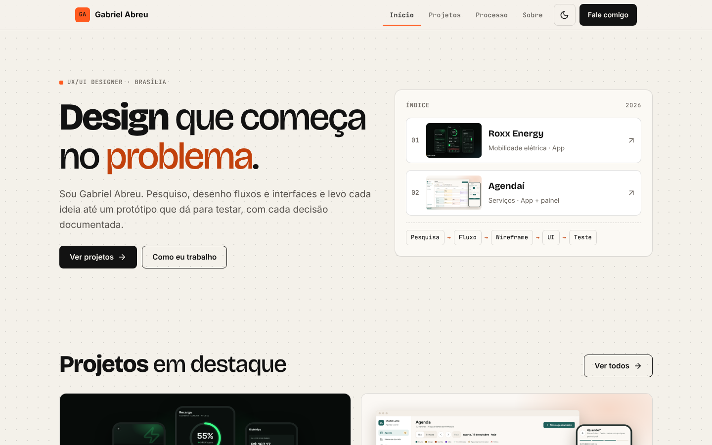
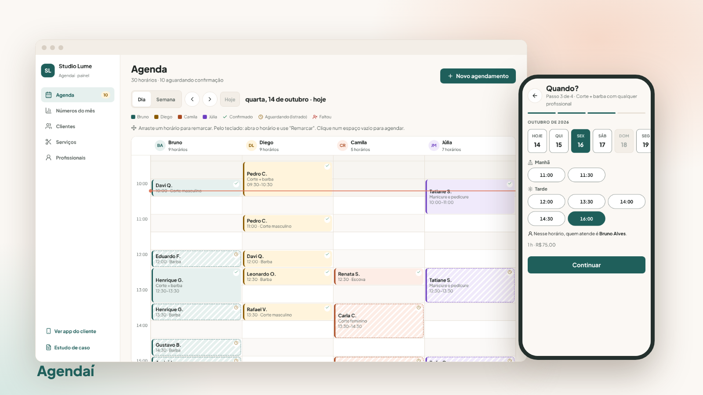
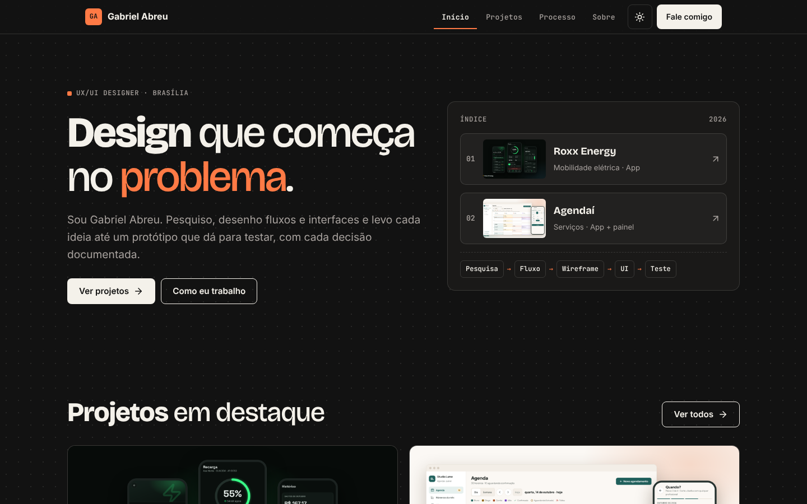
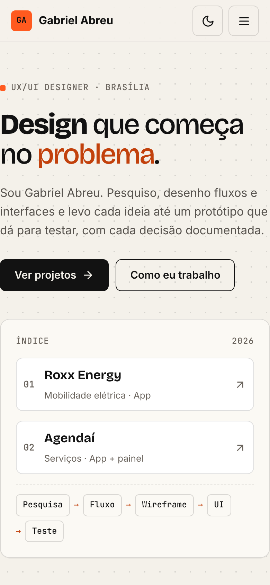
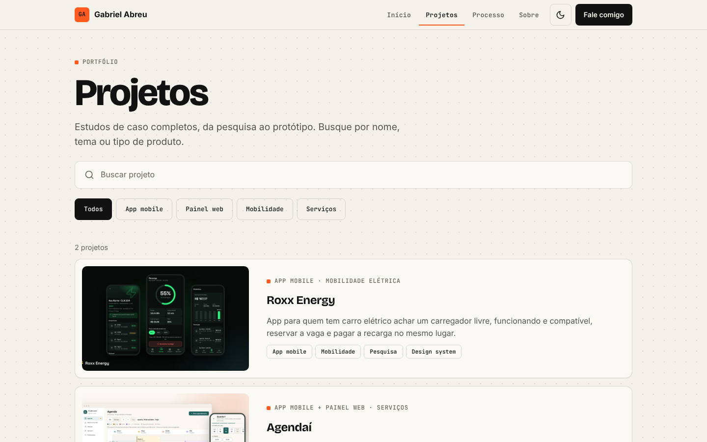
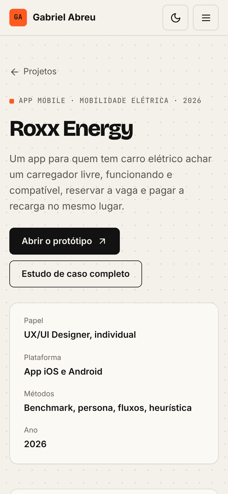

# Gabriel Abreu

**UX/UI Designer · Brasília**

Desenho produtos digitais do problema ao protótipo. Aqui estão dois projetos completos, cada um com pesquisa, fluxos, wireframes, interface, design system, avaliação heurística e um protótipo de alta fidelidade que dá para testar.

**Ver o portfólio:** https://gabrielabreu-it.github.io/projetos/



## Projetos

### [Roxx Energy](roxx-energy/)


App para quem tem carro elétrico achar um carregador livre, funcionando e compatível, reservar a vaga e pagar a recarga.

| Tipo | Papel | Métodos |
|---|---|---|
| App iOS e Android | UX/UI, projeto individual | Benchmark, proto-persona, jornada, fluxos, wireframes, avaliação heurística |

[Estudo de caso](https://gabrielabreu-it.github.io/projetos/roxx-energy/) · [Protótipo](https://gabrielabreu-it.github.io/projetos/roxx-energy/prototipo/) · [Design system](https://gabrielabreu-it.github.io/projetos/roxx-energy/design-system/) · [Documentação](roxx-energy/docs/)

### [Agendaí](agendai/)



Agendamento para salão, barbearia e estética: o cliente marca sozinho e o dono organiza a agenda e acompanha o mês.

| Tipo | Papel | Métodos |
|---|---|---|
| App do cliente e painel do dono | UX/UI, projeto individual | Benchmark, duas proto-personas, jornada, fluxos, wireframes, avaliação heurística |

[Estudo de caso](https://gabrielabreu-it.github.io/projetos/agendai/) · [Protótipo](https://gabrielabreu-it.github.io/projetos/agendai/prototipo/) · [Design system](https://gabrielabreu-it.github.io/projetos/agendai/design-system/) · [Documentação](agendai/docs/)

## Como eu trabalho

1. **Pesquisa.** Benchmark de produtos reais, proto-persona assumida como hipótese e jornada com as dores.
2. **Fluxo.** Arquitetura de informação e os caminhos principais, incluindo os de erro.
3. **Wireframe.** Telas em cinza no tamanho real, para decidir o que aparece e em que ordem.
4. **UI.** Design system com tokens e estados, contraste conferido e protótipo navegável.
5. **Teste.** Avaliação heurística do que fiz, correções e um roteiro de teste com usuários.

## Contato

- LinkedIn: https://www.linkedin.com/in/SEU-USUARIO
- GitHub: https://github.com/gabrielAbreu-it

## Como rodar no computador

Não precisa instalar nada. Abra o `index.html` no navegador ou, para tudo funcionar igual ao GitHub Pages, rode um servidor simples na pasta acima do repositório:

```bash
python3 -m http.server 8080
# depois abra http://localhost:8080/projetos/
```

As fontes vêm do Google Fonts e os ícones do Lucide (versão 0.453.0), os dois por CDN.

## Estrutura

```
/
├── index.html          vitrine do portfólio
├── projetos/           lista de projetos com busca e uma página-resumo por projeto
├── classico.html       versão anterior da vitrine, mantida como referência
├── assets/             estilos e imagens compartilhados
├── roxx-energy/        projeto 1
│   ├── index.html      estudo de caso
│   ├── prototipo/      protótipo navegável
│   ├── design-system/  tokens e componentes
│   └── docs/           pesquisa, fluxos, wireframes e prints
└── agendai/            projeto 2 (mesma estrutura)
```

| Tema escuro | Celular |
|---|---|
|  |  |

| Todos os projetos | Página de projeto |
|---|---|
|  |  |
