# Agendaí

Agendamento para salão, barbearia e estética. O **cliente** marca sozinho, sem criar conta. O **dono** organiza a agenda arrastando horários e vê faturamento, faltas e horários mais cheios.

**Papel:** UX/UI Designer, projeto individual · **Tipo:** projeto conceitual, app do cliente e painel do dono · **Ferramentas:** HTML, CSS, JavaScript, Lucide

[Estudo de caso](https://gabrielabreu-it.github.io/projetos/agendai/) · [Protótipo](https://gabrielabreu-it.github.io/projetos/agendai/prototipo/) · [Design system](https://gabrielabreu-it.github.io/projetos/agendai/design-system/) · [Wireframes](https://gabrielabreu-it.github.io/projetos/agendai/docs/wireframes/) · [Documentação completa](docs/)


## Resumo

- **Problema:** o dono atende pelo WhatsApp, perde horário, esquece de confirmar e não sabe quanto faturou no mês.
- **Solução:** link de agendamento sem cadastro para o cliente e um painel em que o dono arrasta horários para remarcar e vê faturamento, faltas e horários mais cheios.
- **Resultado:** duas interfaces navegáveis com 14 telas, design system com 8 componentes, benchmark de 5 produtos e avaliação heurística com 7 problemas encontrados e 6 corrigidos.

## Problema

O dono de um salão pequeno atende pelo WhatsApp: perde horário quando demora a responder, esquece de confirmar e o cliente falta, e não tem visão do faturamento.

**Objetivo:** tirar o agendamento da conversa sem obrigar o cliente a criar conta, e dar ao dono uma agenda que ele organiza em segundos e que mostra os números do mês.

## Processo

1. **Benchmark** de Booksy, Trinks, AppBarber, Fresha e Google Agenda, com tabela de funcionalidades, pontos fortes e falhas → [docs/01](docs/01-problema-e-benchmark.md)
2. **Proto-personas** (hipótese, ainda não validadas) da dona e do cliente, e **jornada** da dona → [docs/02](docs/02-persona-e-jornada.md)
3. **Arquitetura de informação e fluxos** das duas interfaces → [docs/03](docs/03-arquitetura-e-fluxos.md)
4. **Wireframes** de baixa fidelidade: 6 telas do app e 3 do painel → [docs/wireframes](docs/wireframes/index.html)
5. **Decisões de UI e acessibilidade**, com contraste WCAG AA calculado → [docs/04](docs/04-decisoes-de-ui-e-acessibilidade.md)
6. **Avaliação heurística** do meu protótipo: 7 achados, 6 corrigidos → [docs/05](docs/05-avaliacao-heuristica.md)
7. **Roteiro de teste de usabilidade** (próximo passo) → [docs/06](docs/06-roteiro-de-teste.md)
8. **Próximos passos, métricas de sucesso e aprendizados** → [docs/07](docs/07-proximos-passos.md)

### O que levei do benchmark

| Observação | Decisão no Agendaí |
|---|---|
| Cliente de salão de bairro não quer mais uma conta | Agendamento sem cadastro: nome e WhatsApp só no último passo |
| A agenda divide espaço com módulos raros | A agenda é a tela inicial do painel |
| WhatsApp é o canal real no Brasil | Confirmação e lembrete pelo WhatsApp, com status "aguardando confirmação" |
| Remarcar costuma ser formulário | Arrastar para remarcar, com Desfazer e caminho pelo teclado |

### Fluxo do cliente

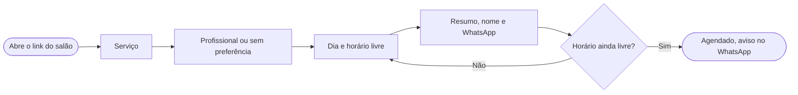

### Fluxo do dono: remarcar

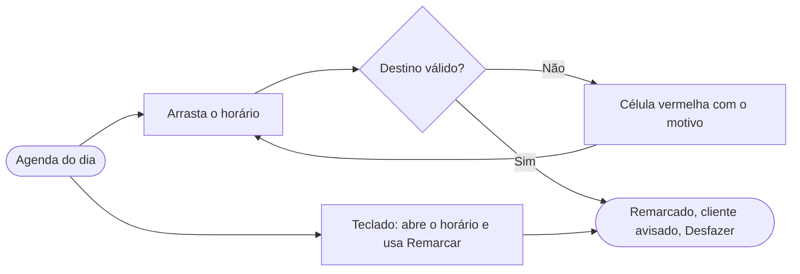

## Telas do app do cliente

| Início | Serviço | Profissional | Data e hora |
|---|---|---|---|
| 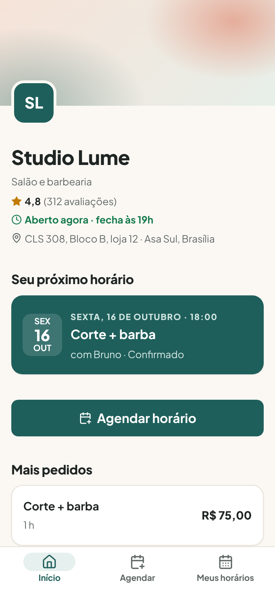 | 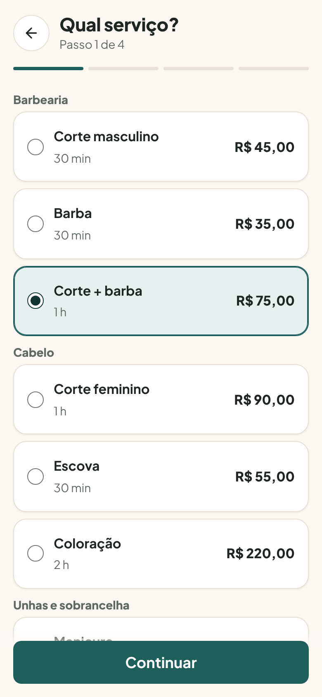 | 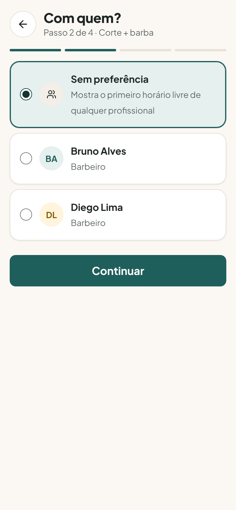 | 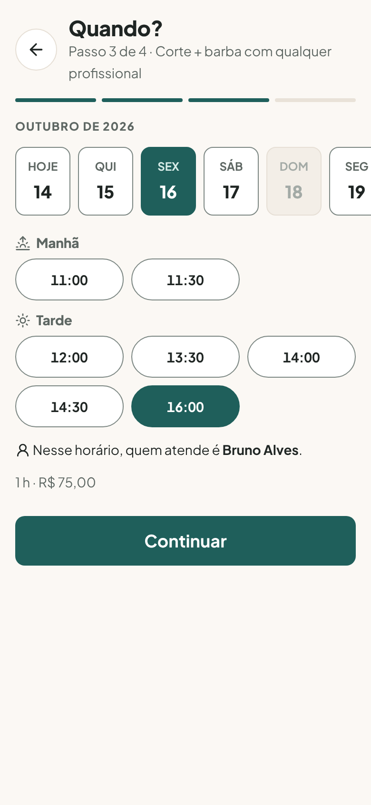 |

| Confirmar | Agendado | Meus horários | Cancelar |
|---|---|---|---|
| 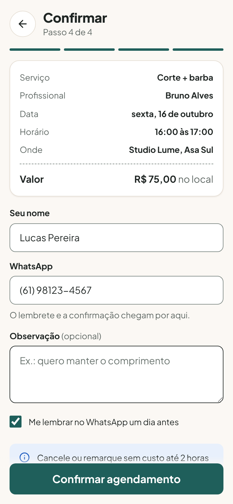 | 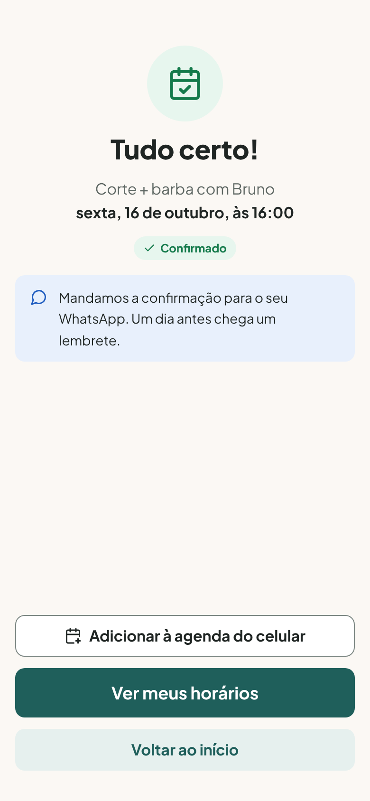 | 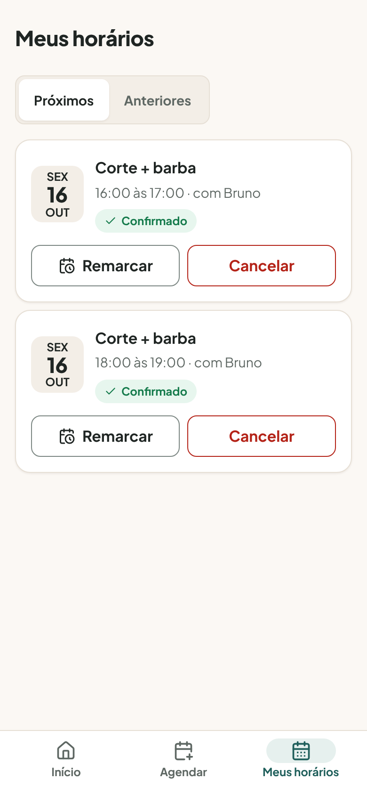 | 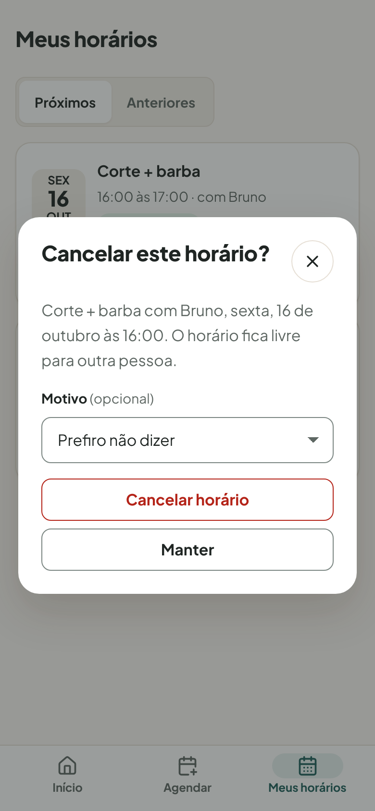 |

## Telas do painel do dono

**Agenda do dia**, uma coluna por profissional:

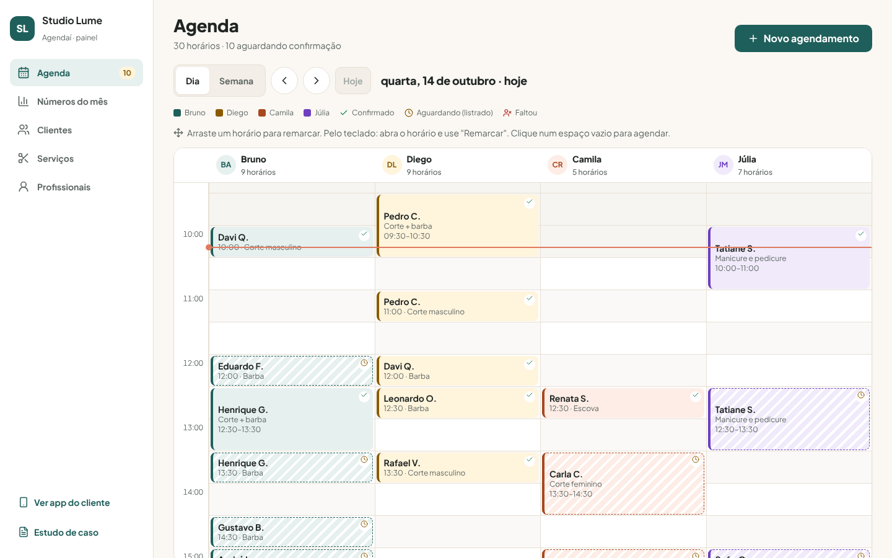

**Arrastar para remarcar**, com o destino destacado antes de soltar:

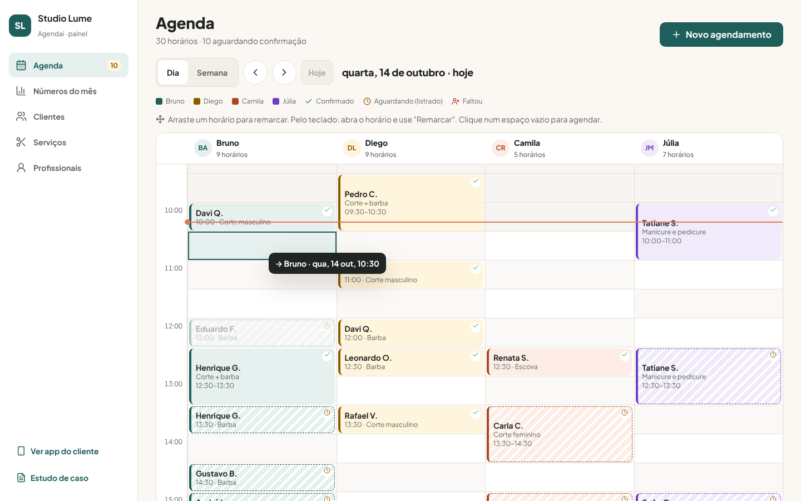

**Números do mês**: faturamento, atendimentos, taxa de faltas e ticket médio:

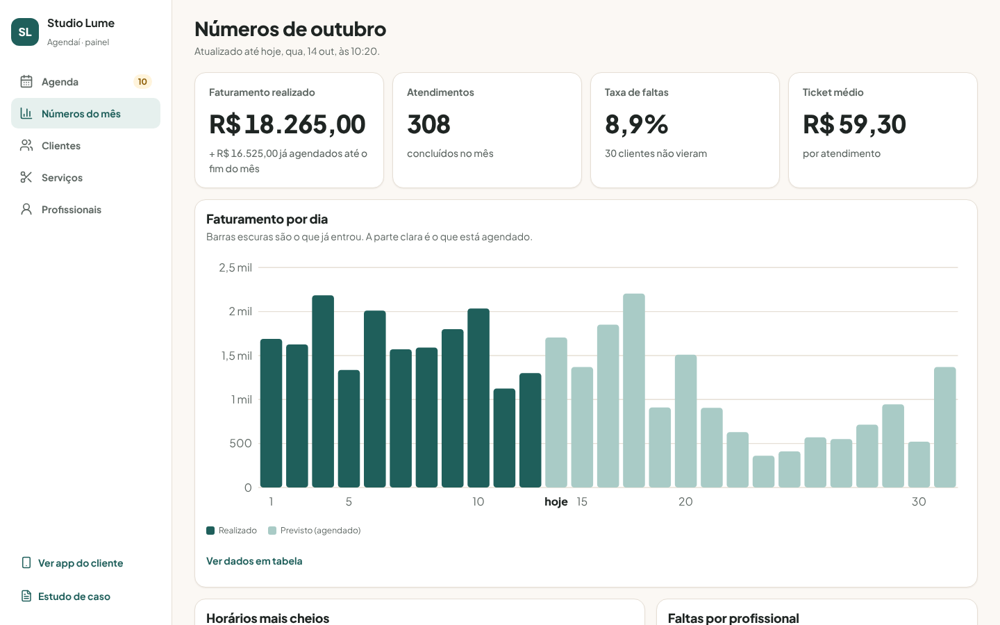

| Horários mais cheios | Ficha do cliente |
|---|---|
| 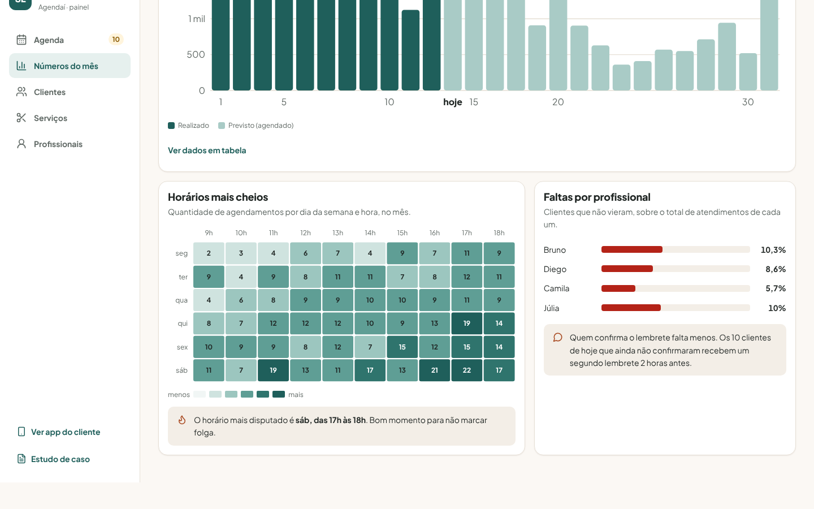 | 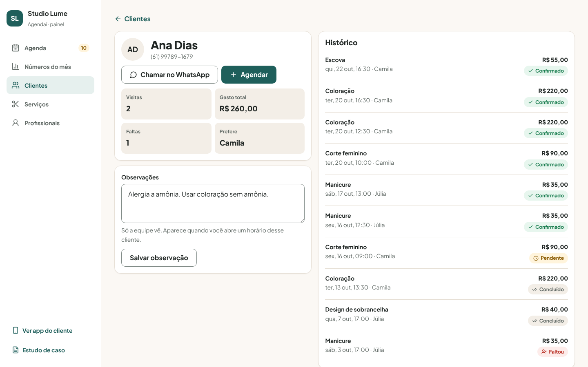 |

| Semana | Serviços |
|---|---|
| 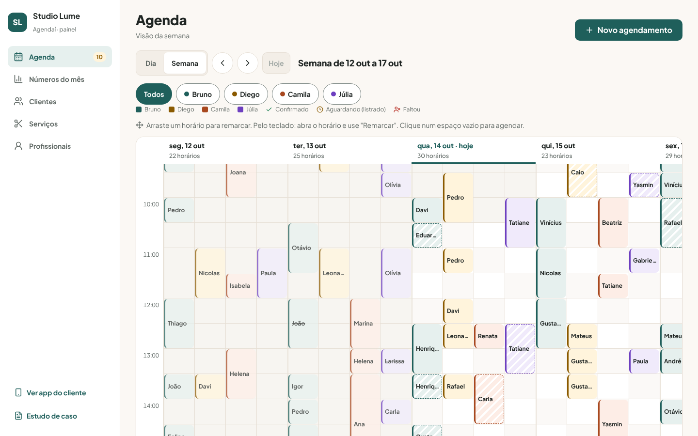 | 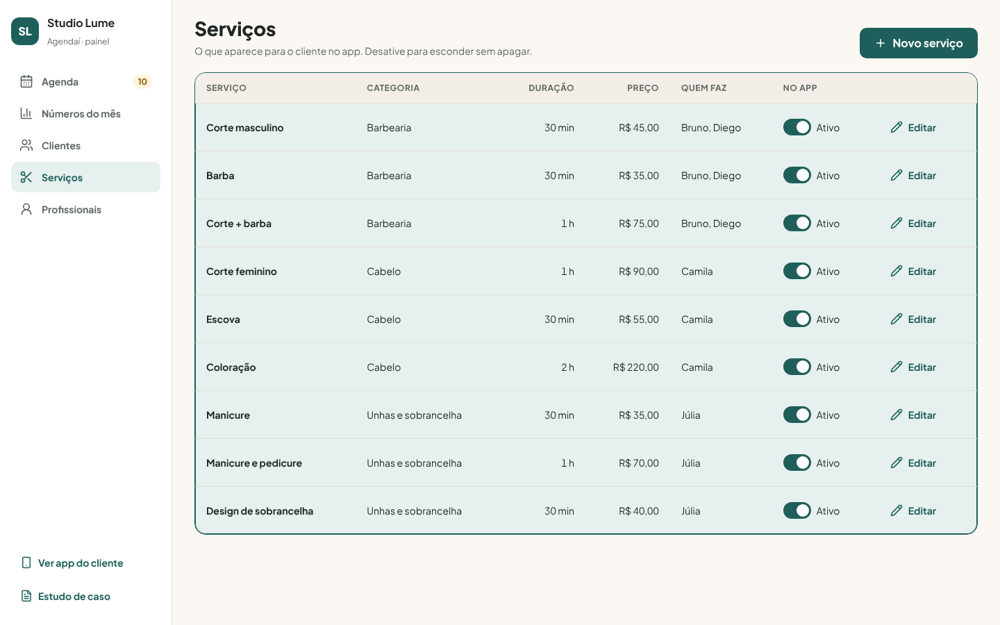 |

| Painel no celular | Números no celular | Clientes no celular |
|---|---|---|
| 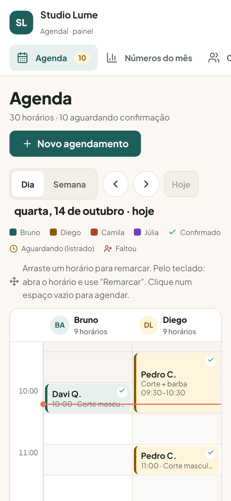 | 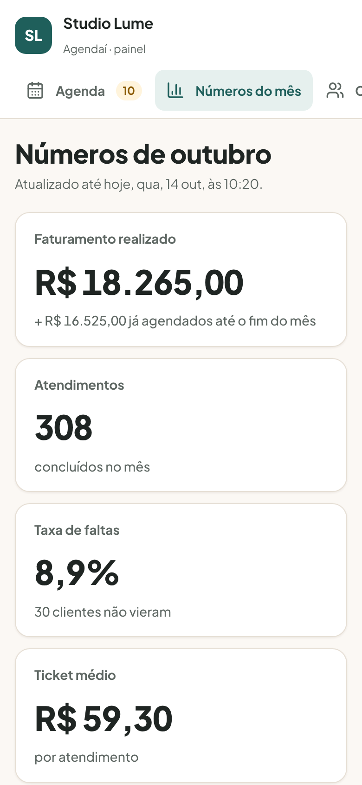 | 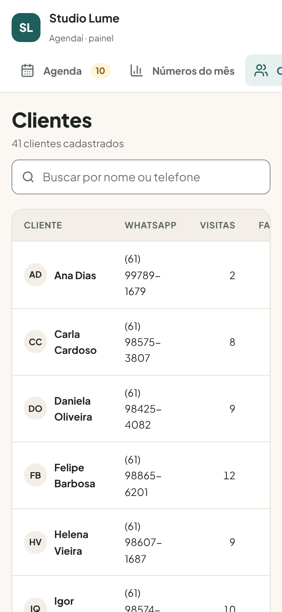 |

## Acessibilidade

- Contraste AA calculado para todos os pares de cor (texto principal 14,72:1, branco no botão 7,38:1).
- Alvos de 44px também no painel, foco visível, labels em todos os campos.
- Arrastar não é o único jeito de remarcar: todo horário abre um detalhe com "Remarcar" pelo teclado.
- Gráficos com tabela equivalente; o mapa de calor mostra o número em cada célula.

## Estrutura

```
agendai/
├── index.html          estudo de caso
├── prototipo/
│   ├── index.html      entrada: escolha entre cliente e painel
│   ├── cliente/        app do cliente (mobile)
│   ├── painel/         painel do dono (desktop e responsivo)
│   └── shared/         dados fictícios, regras e componentes de toast e modal
├── design-system/      tokens.css, components.css e a página com todos os estados
└── docs/               pesquisa, fluxos, wireframes e prints
```

Dados fictícios. O que você agendar no app do cliente aparece no painel, no mesmo navegador.
