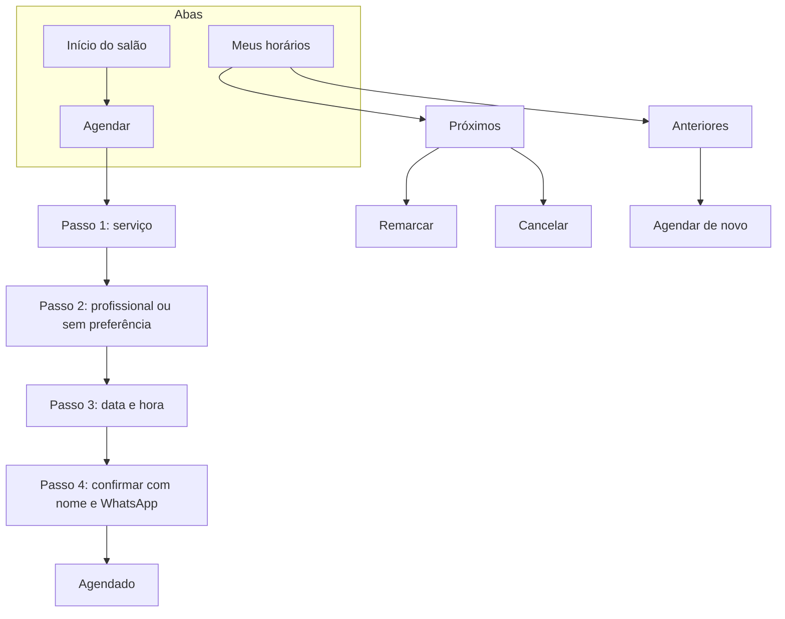
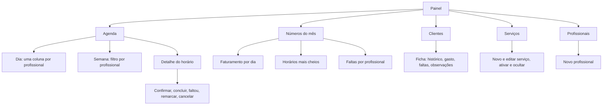
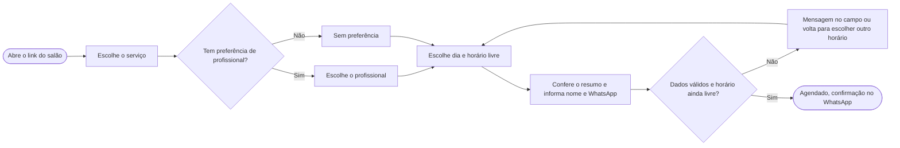
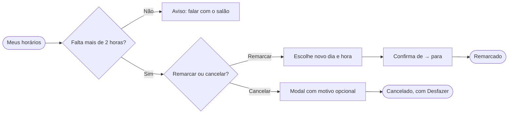
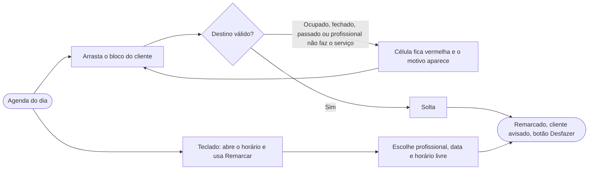

# 3. Arquitetura de informação e fluxos

[← Voltar ao índice](README.md)

## Arquitetura de informação

### App do cliente

Três abas. "Agendar" abre o fluxo em quatro passos.

### Painel do dono

Cinco itens de menu. A agenda é a tela inicial.

## Fluxo do cliente: agendar

## Fluxo do cliente: remarcar e cancelar

## Fluxo do dono: remarcar arrastando

## Priorização do MVP

Com os fluxos desenhados, separei o que entra na primeira versão. O critério: o que resolve a dor principal da jornada entra primeiro.

| Prioridade | O que | Por quê |
|---|---|---|
| Precisa ter | Agendar em 4 passos sem cadastro, só horários livres, agenda por profissional, remarcar e cancelar dos dois lados, status de confirmação | Resolve as três dores: horário perdido, falta e mensagem sem resposta |
| Deveria ter | Arrastar para remarcar, números do mês, ficha do cliente com observações | Deixam o dono mais rápido e dão visão do negócio |
| Poderia ter | Ir para uma data, lista de espera, bloqueio de agenda | Ajustes de quem já usa no dia a dia |
| Não agora | Comissões, estoque, pagamento online, marketplace | Aumentam muito o escopo e afastam o foco da agenda |
