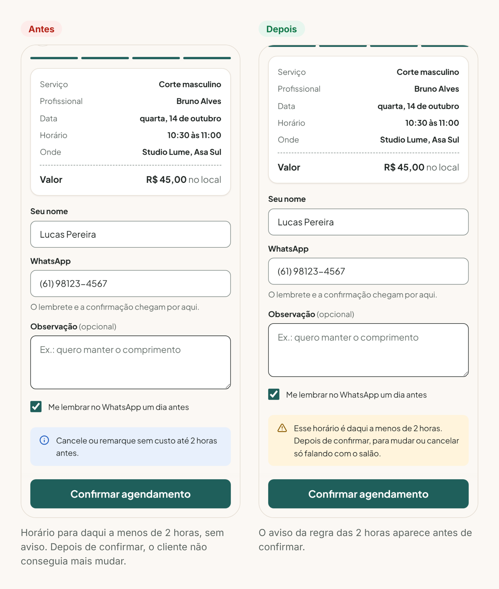
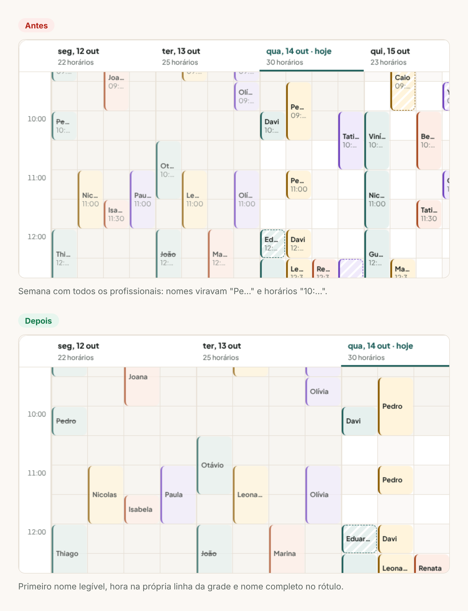
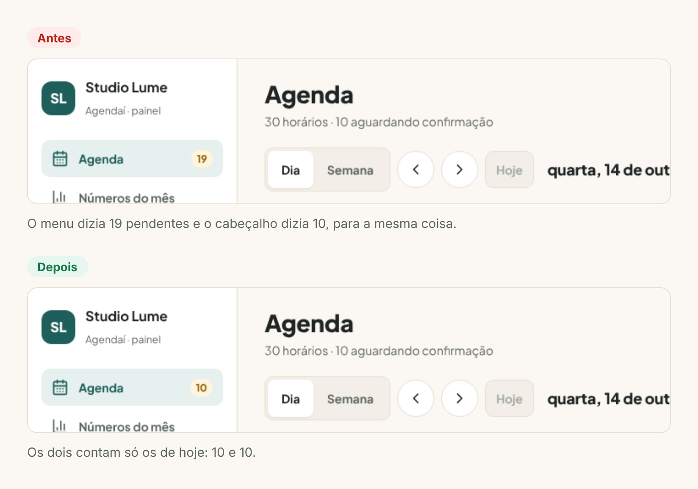

# 5. Avaliação heurística

[← Voltar ao índice](README.md)

Com as duas interfaces prontas, passei por todas as telas com as 10 heurísticas de Nielsen. Avaliei sozinho: serve para pegar os problemas óbvios antes do teste com usuários, não para substituí-lo.

Gravidade na escala do Nielsen: **0** não é problema · **1** cosmético · **2** pequeno · **3** grande · **4** catástrofe.

| # | Heurística | Onde | O que encontrei | Grav. | O que fiz |
|---|---|---|---|---|---|
| 1 | Visibilidade do status | Cliente | Com "Sem preferência", a pessoa escolhia o horário sem saber com quem ia ser atendida. Só descobria no resumo. | 1 | Ao escolher o horário aparece "Nesse horário, quem atende é Diego Lima". |
| 2 | Correspondência com o mundo real | Ambos | Conferi os termos: "aguardando confirmação", "faltou", "remarcar", "ticket médio". São os que o dono de salão já usa. | 0 | Nada a corrigir. |
| 3 | Controle e liberdade | Painel | Marcar "Concluído" ou "Faltou" por engano só podia ser desfeito pelo toast, que some em 7 segundos. | 2 | O detalhe de um horário concluído ou com falta ganhou o botão "Marquei errado". |
| 4 | Consistência e padrões | Painel | O menu mostrava "Agenda 19" (todos os pendentes dos próximos dias) e o cabeçalho da agenda dizia "10 aguardando confirmação" (só hoje). Dois números para a mesma coisa. | 2 | O número do menu passou a contar só os de hoje, igual ao cabeçalho, e o rótulo acessível diz isso. |
| 5 | Prevenção de erros | Cliente | Dava para marcar um horário para daqui a 1 hora sem aviso. Logo depois de confirmar, o app dizia que não dava mais para remarcar ou cancelar (regra de 2 horas). | 2 | Quando o horário é em menos de 2 horas, o aviso aparece antes de confirmar. |
| 6 | Reconhecer em vez de lembrar | Painel | Conferi: o detalhe do horário mostra a observação da ficha do cliente (ex.: alergia), sem precisar abrir a ficha. | 0 | Nada a corrigir. |
| 7 | Flexibilidade e eficiência | Painel | Para ver um dia daqui a três semanas, é preciso clicar "próximo" várias vezes. Não existe "ir para data". | 1 | Não corrigi agora. Está nos próximos passos. |
| 8 | Estética e design minimalista | Painel | Na semana com todos os profissionais, cada bloco mostrava nome e hora em 46px de largura: virava "Pe…" e "10:…", ilegível. | 2 | No modo "Todos" o bloco mostra só o primeiro nome (a hora já está na linha), a coluna ganhou largura mínima de 64px e o texto completo fica no rótulo. |
| 9 | Reconhecer e corrigir erros | Ambos | Conferi: arrastar para um horário inválido mostra o motivo antes de soltar ("Bruno já tem cliente nesse horário", "Esse horário já passou"). Telefone errado diz o formato esperado. | 0 | Nada a corrigir. |
| 10 | Ajuda e documentação | Painel | A dica "arraste um horário para remarcar" ficava embaixo da grade e, numa tela de notebook, saía da área visível. | 1 | Subi a dica para cima da grade. |

## Resumo

- 7 achados no total. Em 3 das 10 heurísticas não encontrei problema.
- 6 corrigidos no protótipo, 1 foi para os próximos passos.
- Nenhum achado de gravidade 3 ou 4. Os de gravidade 2 eram de controle e consistência: coisas que fazem o dono desconfiar do sistema, que é o maior risco para quem está saindo do papel.

## Antes e depois

