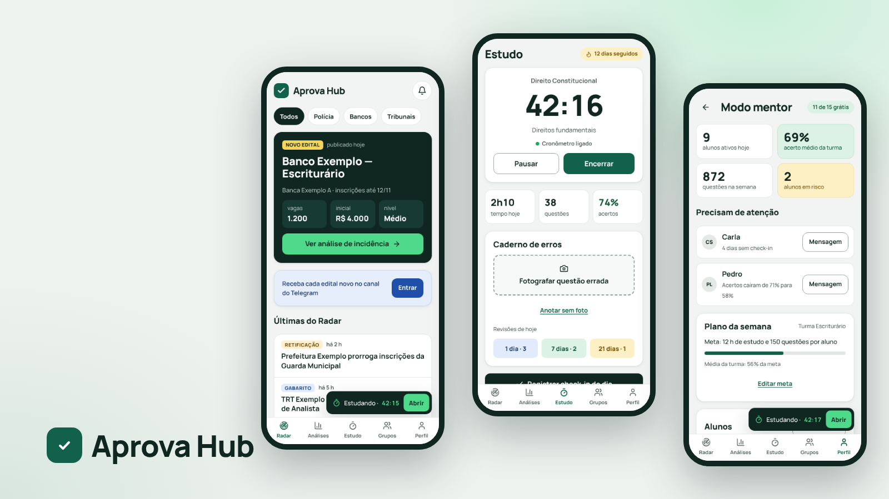

# Aprova Hub

App web instalável para quem estuda para concurso público: radar de editais, análise do que mais cai por banca, estudo com cronômetro, caderno de erros com foto e revisão em 1, 7 e 21 dias, grupos com ranking e quiz relâmpago. Grátis para o aluno, com plano Premium. Inclui o Modo mentor (grátis até 15 alunos), que nasceu do projeto [Mentor OS](../mentor-os/).

**Papel:** UX/UI Designer, projeto individual · **Tipo:** projeto conceitual, 2026 · **Métodos:** benchmark, proto-persona (hipótese), jornada, fluxos, avaliação heurística, protótipo funcional e modelo de negócio

[Página do projeto](https://gabriel-abreu-portfolio.vercel.app/projetos/aprova-hub.html) · [App de demonstração](https://gabriel-abreu-portfolio.vercel.app/aprova-hub/prototipo/) · [Documentação](docs/) · [Estrutura do banco](supabase/schema.sql) · [Como colocar no ar](COMO-COLOCAR-NO-AR.md)

Editais ao vivo: [Editais resumidos](editais/index.html), página pública com as publicações de concursos nos diários oficiais municipais (fonte: Querido Diário), resumidas e com o link oficial. Veja a [função /api/editais](../api/README.md).

Demonstração do piloto automático: [Página de vendas](site/index.html) · [Afiliados](site/afiliados.html) · [Ajuda](site/ajuda.html) · [Painel do dono](admin/index.html) · [Como funciona](docs/08-piloto-automatico.md)

- **Problema:** o concurseiro junta edital em grupo de mensagens, estatística de prova em planilha e erro em caderno de papel, e estuda sozinho sem saber se está no ritmo.
- **Solução:** um app com cinco abas (Radar, Análises, Estudo, Grupos e Perfil), o Modo mentor para quem acompanha alunos e uma página pública com os editais do dia resumidos. O Radar usa dados reais dos diários oficiais quando publicado.
- **Negócio (hipóteses):** Aprova Premium para o aluno (R$ 29,90/mês, Pix Automático por um provedor de pagamento), indicação, canal de Telegram e convite por WhatsApp para crescer, plano Mentor Pro acima de 15 alunos e plano para escola ou cursinho.

Versão de demonstração: os dados ficam salvos só neste aparelho. Órgãos, bancas, nomes, telefones, números e questões são fictícios.
