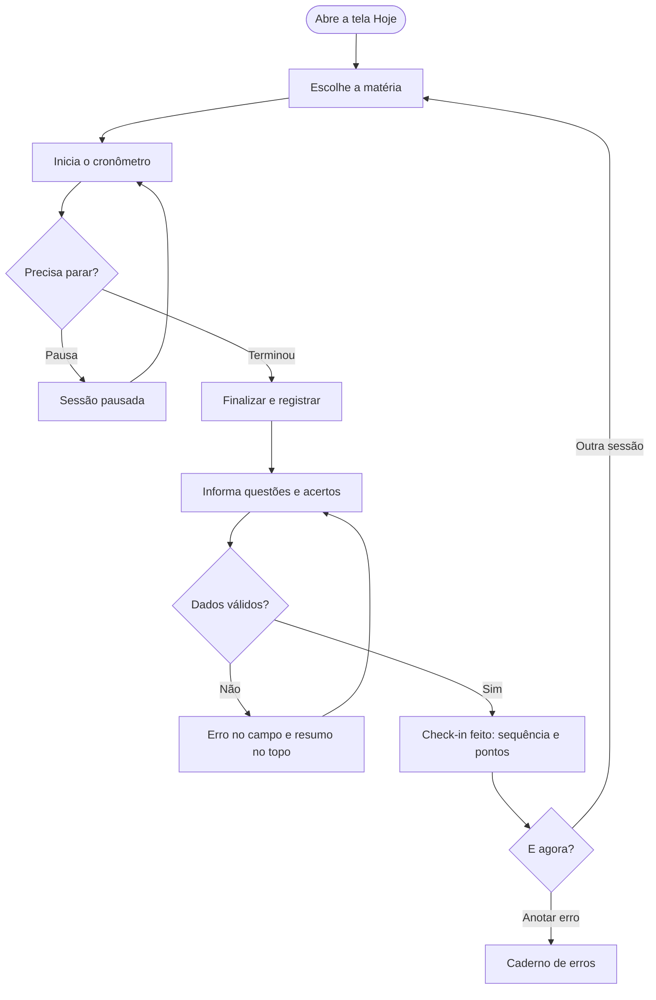
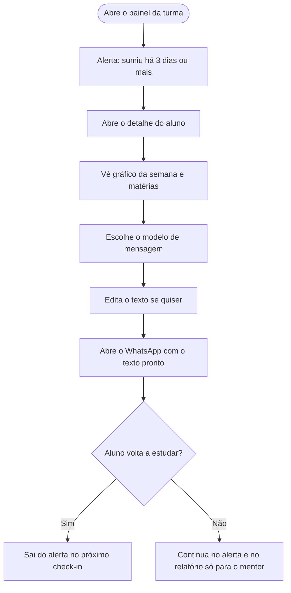

# 03 · Fluxos

## Mapa do app

Um app só, com seletor "Sou aluno" e "Sou mentor".

- **Aluno**
  - **Hoje:** check-in com cronômetro, sequência de dias, plano da semana com progresso
  - **Ranking:** faixa da semana, sua evolução, regra dos pontos, turma por faixa
  - **Simulado:** 10 questões, correção na hora, mandar erros para o caderno
  - **Caderno de erros:** fila "revisar hoje", registro de erro, lista com etapas 1, 7 e 21 dias
- **Mentor**
  - **Turma:** indicadores, alertas, lista de alunos com filtros e busca
  - **Detalhe do aluno:** gráfico da semana, matérias, mensagem no WhatsApp
  - **Plano da semana:** metas por matéria e recado
  - **Simulado:** acerto por questão, distribuição, quem não fez
  - **Relatório:** versão para a turma e versão só para o mentor

## Fluxo do aluno: check-in

Caminho alternativo: "Estudei sem cronômetro" abre o mesmo formulário com o tempo em branco.

## Fluxo do mentor: aluno sumiu

## Regras que definem os alertas

- **Sumiu:** nenhum check-in há 3 dias ou mais.
- **Abaixo da meta:** menos de 70% das questões esperadas até hoje. O esperado é a meta da semana dividida pelos dias que já passaram.
- **Ranking:** 1 ponto por acerto (até 60 por dia) + 15 pontos por dia com check-in + 3 pontos por acerto no simulado. Faixas em terços da turma.

## Estados que desenhei

| Tela | Estados |
|---|---|
| Hoje | sem sessão, cronômetro ligado, pausado, finalizar com erro, confirmação, sem plano publicado |
| Ranking | cada uma das 3 faixas, com e sem próxima faixa |
| Simulado | apresentação, respondendo (com rascunho guardado), questões em branco, resultado |
| Caderno | fila com itens, fila vazia, filtro sem resultado, erro no formulário |
| Turma | com alertas, sem alertas, filtro sem resultado, adicionar aluno com erro |
| Detalhe | aluno encontrado, aluno não encontrado |
| Plano | edição, erro por linha, publicado |
| Simulado do mentor | com resultados, ninguém fez ainda |
