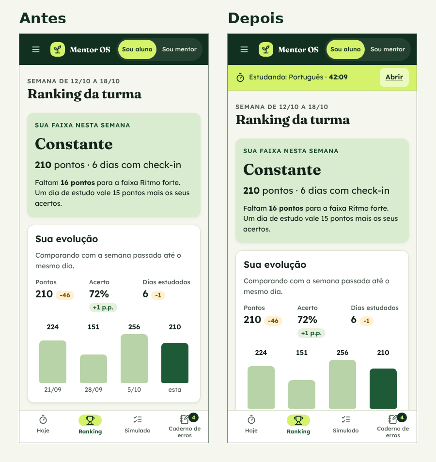

# 05 · Avaliação heurística

Avaliei a primeira versão funcional do app com as 10 heurísticas de Nielsen, passando por todas as telas das duas visões. Severidade de 1 (cosmético) a 4 (catastrófico).

Fiz em duas passadas: uma pelos fluxos principais (check-in e alerta de aluno sumido) e outra pelos estados de erro, vazio e confirmação, no celular e no computador.

**Resultado:** 8 problemas encontrados, 6 corrigidos nesta versão e 2 deixados para a próxima.

| # | Problema | Heurística | Severidade | Correção | Status |
|---|---|---|---|---|---|
| 1 | Com o cronômetro ligado, ao sair da tela Hoje não havia nenhum sinal de que ele continuava contando | H1 Visibilidade do estado do sistema | 3 | Faixa fixa no topo com matéria, tempo correndo e atalho para o cronômetro | Corrigido |
| 2 | Respostas do simulado se perdiam ao trocar de tela no meio da prova | H5 Prevenção de erros | 3 | Rascunho guardado ao sair e aviso no contador de respostas | Corrigido |
| 3 | O tempo vindo do cronômetro não podia ser corrigido quando a pessoa esquecia de pausar | H3 Controle e liberdade | 2 | Campo editável com a dica "Esqueceu de pausar? Corrija aqui." | Corrigido |
| 4 | "Revisei e acertei" tirava o erro da fila sem volta | H3 Controle e liberdade | 2 | Botão "Desfazer" no aviso | Corrigido |
| 5 | No celular, a sequência de dias só aparecia no fim da tela Hoje | H6 Reconhecer em vez de lembrar | 2 | Selo "13 dias seguidos" logo abaixo do título | Corrigido |
| 6 | No detalhe do aluno, "49 / 210" não dizia o que era o 210 | H2 Correspondência com o mundo real | 1 | Rótulo "Questões (meta 210)" e percentual da meta | Corrigido |
| 7 | Não dá para editar uma sessão registrada, só excluir e registrar de novo | H3 Controle e liberdade | 2 | Abrir a sessão com opção de editar | Pendente |
| 8 | Aluno novo não recebe explicação inicial de pontos, faixas e revisões | H10 Ajuda e documentação | 2 | Três telas de boas-vindas no primeiro acesso | Pendente |

## Antes e depois: cronômetro esquecido

**Antes:** a aluna ligava o cronômetro, ia olhar o ranking e esquecia que ele estava correndo. Voltava horas depois com um tempo irreal.

**Depois:** em qualquer outra tela aparece uma faixa lima no topo com "Estudando: Português · 42:09" e o botão "Abrir". Se mesmo assim o tempo ficar errado, o campo de tempo pode ser corrigido ao finalizar (problema 3).

## O mais grave

Os problemas 1 e 2 têm severidade 3 porque mexem com o dado que alimenta o ranking e os alertas do mentor. Se o tempo ou o simulado ficam errados, a confiança no app cai para os dois lados.

## Por que os pendentes ficaram para depois

- **Editar sessão (7):** precisa de regra para não virar brecha no ranking (por exemplo, editar só no mesmo dia). Quero ver no teste se as pessoas sentem falta.
- **Boas-vindas (8):** a regra dos pontos já está na tela de ranking. Vou decidir o conteúdo do primeiro acesso depois de ouvir o que os alunos não entenderam.
