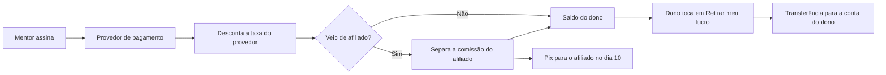

# 08 · Piloto automático

Aqui explico, de forma simples, como o Aprova Hub poderia se vender, se cobrar e pagar o dono sozinho. **Tudo o que existe hoje é demonstração com dados fictícios**: a [página de vendas](../site/index.html), o [cadastro com pagamento simulado](../site/cadastro.html), o [programa de afiliados](../site/afiliados.html), a [central de ajuda](../site/ajuda.html) e o [painel do dono](../admin/index.html). Nenhum dinheiro é movimentado.

## Como o dinheiro anda

1. O mentor escolhe o plano e paga por Pix, boleto ou cartão. Quem processa é um **provedor de pagamento** (por exemplo, o Asaas), não o Aprova Hub.
2. O provedor desconta a taxa dele. Na demonstração uso uma **estimativa de 3%**, que é só hipótese: as taxas e regras reais precisam ser conferidas no site do provedor.
3. Se o cliente chegou pelo link de um afiliado, a **comissão** (hipótese de 30%) é separada na hora, com a função de divisão de pagamento do provedor, se ele tiver. O afiliado recebe por Pix no dia 10 do mês seguinte.
4. O que sobra fica como **saldo do dono**.
5. No painel, o dono toca em **"Retirar meu lucro"**, escolhe o valor e confirma. A transferência vai para a conta bancária cadastrada.

## O que roda sozinho

| Parte | Como funcionaria |
|---|---|
| Cadastro | O mentor cria a conta e começa o teste grátis sem falar com ninguém |
| Cobrança | Mensalidade recorrente gerada pelo provedor, com recibo por e-mail |
| Liberação e bloqueio | Pagamento confirmado libera o acesso; atraso pausa o painel depois de alguns dias, sem apagar dados |
| E-mails e avisos | Boas-vindas, fim do teste (2 dias antes), cobrança, atraso e recibo |
| Comissões | Separadas a cada pagamento e pagas no dia 10 |
| Relatórios | Painel do dono com receita, MRR, assinantes, inadimplência, origem dos clientes e lucro estimado |

## O que continua manual

- **Suporte** que a central de ajuda não resolve.
- **Impostos**, nota fiscal e contabilidade (com um contador).
- **Revisão jurídica** dos termos de uso, da política de privacidade e das regras de afiliados.
- Decidir preços, olhar os números uma vez por semana e responder quem cancela.

## O que precisa existir para virar produção

> **Fase de produção, ainda não iniciada.**

- [ ] Empresa aberta (CNPJ) e conta no provedor de pagamento escolhido, com as taxas e regras conferidas no site dele
- [ ] Projeto no Supabase com o [schema](../supabase/schema.sql) e login ligado
- [ ] Trocar o armazenamento no aparelho (`store.js` e `site/negocio.js`) por chamadas ao banco
- [ ] Avisos automáticos do provedor (webhooks) ligados à liberação e ao bloqueio do acesso
- [ ] Domínio próprio e e-mail de envio configurado
- [ ] Termos de uso, privacidade e regras de afiliados revisados por advogado
- [ ] Contador para impostos e emissão de nota

## Hipóteses que preciso validar

- Os preços (R$ 97, R$ 197 e R$ 790 por mês) e o teste de 7 dias.
- A comissão de 30% recorrente: atrai afiliados sem comer a margem?
- A taxa estimada do provedor e os custos fixos usados no lucro estimado.

Todas essas regras podem ser mudadas na tela de **Ajustes** do painel do dono, e a página de vendas mostra o valor novo na hora.
