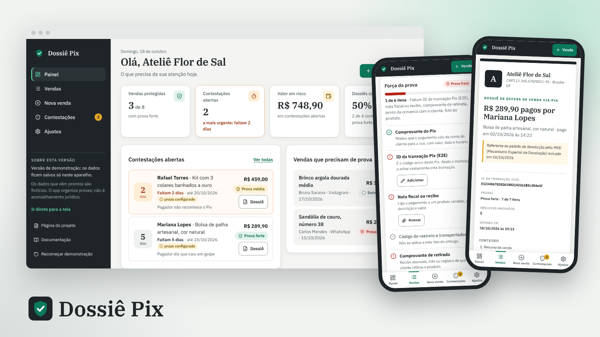

# Dossiê Pix

App web instalável para lojistas que vendem por Pix (loja online, Instagram, WhatsApp) juntarem as provas de cada venda e gerarem um dossiê organizado quando o pagador pede devolução pelo MED (Mecanismo Especial de Devolução do Pix) alegando golpe, mesmo com a venda legítima.

**Papel:** UX/UI Designer, projeto individual · **Tipo:** projeto conceitual, 2026 · **Métodos:** benchmark, proto-persona (hipótese), jornada, fluxos, avaliação heurística e app funcional

[Página do projeto](https://gabriel-abreu-portfolio.vercel.app/projetos/dossie-pix.html) · [App de demonstração](https://gabriel-abreu-portfolio.vercel.app/dossie-pix/prototipo/) · [Documentação](docs/) · [Estrutura do banco](supabase/schema.sql) · [Como colocar no ar](COMO-COLOCAR-NO-AR.md)

- **Problema:** quando chega um pedido de devolução pelo MED, o lojista tem pouco tempo para provar que a venda foi real, e as provas estão espalhadas entre o app do banco, o WhatsApp, o Instagram e a transportadora.
- **Solução:** cada venda vira uma pasta de provas com checklist de força (fraca, média, forte) que diz o que falta; a contestação tem contagem regressiva do prazo que o lojista configurou; o dossiê sai pronto para imprimir ou salvar em PDF.
- **Resultado:** app funcional com 9 telas, dados salvos no aparelho, banco pronto para a versão com login, benchmark de 4 referências e avaliação heurística com 11 problemas encontrados e 9 corrigidos.

Versão de demonstração: os dados ficam salvos só neste aparelho. Os dados de exemplo são fictícios. O app organiza provas; não é aconselhamento jurídico e não garante o resultado da contestação. Prazos e regras do MED dependem do Banco Central e de cada instituição.
