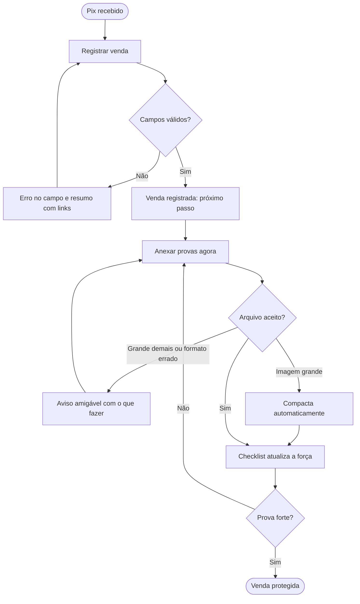
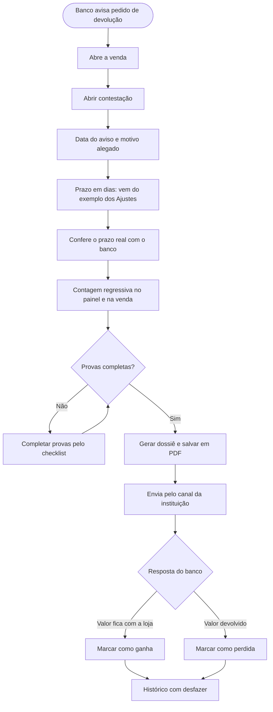

# 03 · Fluxos

## Mapa do app

- **Painel**: vendas protegidas, contestações abertas com contagem regressiva, valor em risco, taxa de dossiês completos e vendas que precisam de prova
- **Vendas**: lista com busca e filtros (sem prova, prova fraca, contestadas, resolvidas)
- **Registrar venda** (e editar): valor, data, cliente, produto, ID do Pix, canal, tipo de entrega
- **Venda registrada**: confirmação com o próximo passo
- **Venda**: força da prova, provas anexadas, rastreio, linha do tempo, dados, histórico
- **Abrir contestação**: data do aviso, motivo alegado, prazo configurável
- **Dossiê**: documento para imprimir ou salvar em PDF
- **Contestações**: abertas e histórico com resultado
- **Ajustes**: dados da loja, logo, prazo padrão e cópia dos dados

No computador, menu lateral; no celular, barra inferior com Painel, Vendas, Nova venda, Contestações e Ajustes.

## Fluxo principal: registrar a venda e guardar as provas

## Fluxo da contestação

## Estados de cada tela

| Tela | Estados |
|---|---|
| Painel | com dados, sem nenhuma venda, sem contestação aberta |
| Vendas | lista, busca sem resultado, filtro vazio, nenhuma venda |
| Registrar venda | vazio, erro por campo com resumo, aviso não bloqueante do ID do Pix |
| Venda | sem prova, fraca, média, forte; contestação aberta, perto do prazo, vencida, ganha, perdida |
| Anexar prova | carregando, compactada, arquivo grande, formato não aceito, espaço do navegador cheio |
| Abrir contestação | nova, edição, já resolvida |
| Dossiê | prova forte, aviso de prova incompleta |
| Qualquer venda | venda não encontrada |
