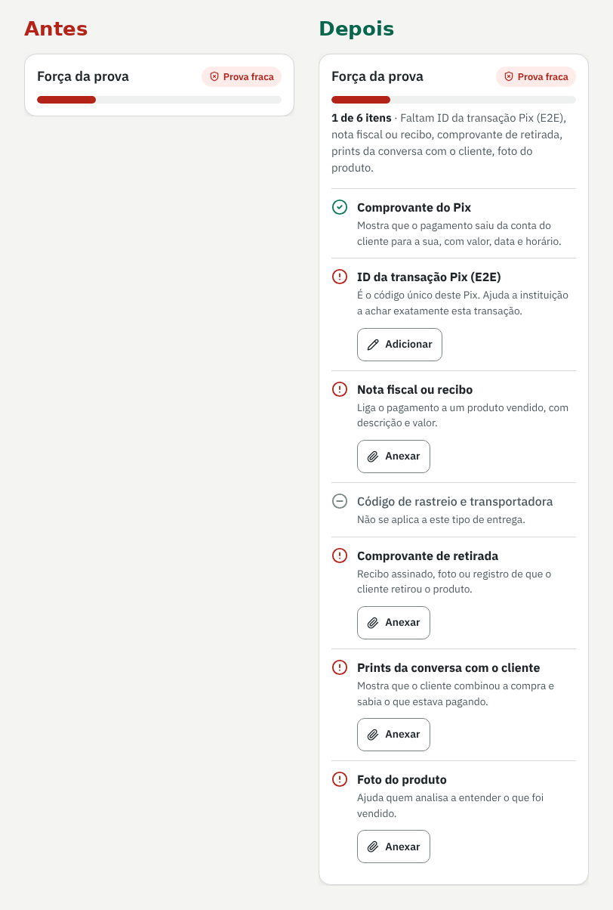

# 05 · Avaliação heurística

Avaliei a primeira versão do meu app com as 10 heurísticas de Nielsen, passando por todas as telas e estados. Severidade de 1 (cosmético) a 4 (catastrófico).

Fiz sozinho, em duas passadas: uma pelo fluxo de registrar a venda e guardar provas, outra pelo fluxo da contestação até o dossiê e o resultado. Como o tema envolve dinheiro e prazo, dei atenção especial a qualquer coisa que pudesse parecer promessa ou regra oficial.

**Resultado:** 11 problemas encontrados, 9 corrigidos nesta versão e 2 deixados para a versão com login.

| # | Problema | Heurística | Severidade | Correção | Status |
|---|---|---|---|---|---|
| 1 | O prazo da contestação aparecia como se fosse regra oficial do MED | H2 Correspondência com o mundo real | 4 | Prazo virou campo configurável, com "exemplo" nos Ajustes, selo "prazo configurado" em toda data e aviso para conferir com a instituição | Corrigido |
| 2 | A força da prova mostrava só o selo "Prova fraca", sem dizer o que faltava | H6 Reconhecer em vez de lembrar | 3 | Checklist com o motivo de cada item e o botão certo ao lado; "3 de 7 itens" e lista do que falta | Corrigido |
| 3 | Arquivo grande falhava sem explicação | H9 Ajudar a reconhecer e corrigir erros | 3 | Limite escrito antes de enviar, compactação automática de fotos e mensagem no campo dizendo o tamanho e o que fazer | Corrigido |
| 4 | "Marcar como ganha/perdida" mudava o status num toque, sem volta | H3 Controle e liberdade | 3 | Diálogo de confirmação com anotação, botão "Desfazer" no aviso e "Desfazer resultado" na venda | Corrigido |
| 5 | Os dados ficavam só no aparelho e nada avisava | H1 Visibilidade do estado do sistema | 3 | Aviso fixo no menu e no rodapé, uso de espaço nos Ajustes e "Baixar cópia dos dados" | Corrigido |
| 6 | Erros do formulário de venda apareciam só no topo | H9 Ajudar a reconhecer e corrigir erros | 2 | Erro no próprio campo, resumo com links e foco no resumo | Corrigido |
| 7 | Lojista não sabia onde achar o ID da transação Pix | H10 Ajuda e documentação | 2 | "Onde encontro esse ID?" no campo e aviso que não bloqueia quando o ID parece incompleto | Corrigido |
| 8 | "Baixar PDF" abria a janela de impressão sem explicar | H10 Ajuda e documentação | 2 | Texto curto na barra do dossiê: escolher "Salvar como PDF" como destino | Corrigido |
| 9 | Busca sem resultado deixava a lista em branco | H1 Visibilidade do estado do sistema | 2 | Contador de resultados e estado vazio com "Limpar busca e filtros" | Corrigido |
| 10 | Nenhum lembrete fora do app quando o prazo está perto | H1 Visibilidade do estado do sistema | 3 | Lembrete por e-mail ou notificação, com base no prazo configurado | Pendente |
| 11 | PDFs anexados não entram dentro do arquivo do dossiê | H7 Flexibilidade e eficiência | 2 | Juntar os PDFs anexados ao dossiê num arquivo só | Pendente |

## Antes e depois: força da prova

**Antes:** o cartão mostrava só o selo "Prova fraca" e a barra. A lojista sabia que estava ruim, mas não sabia o que fazer.

**Depois:** o cartão diz quantos itens estão feitos, lista o que falta, explica por que cada prova importa e coloca o botão certo ao lado de cada item. Itens que não se aplicam ao tipo de entrega (rastreio numa retirada, por exemplo) não contam contra a venda.

## Por que os pendentes ficaram para depois

- **Lembrete fora do app (10)** é importante, mas precisa de login e de um serviço que rode no servidor. O banco já tem o campo de prazo calculado para isso.
- **Juntar PDFs (11)** é útil, mas hoje o dossiê já lista cada PDF e pede para enviá-lo junto. Prefiro ver no teste se isso atrapalha de verdade.
