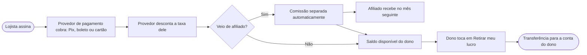

# 08 · Piloto automático (demonstração)

> **Fase de produção: ainda não iniciada.** Tudo o que está aqui é uma demonstração navegável com dados fictícios. Nenhum pagamento é cobrado, nenhuma comissão é paga e nenhum dinheiro é transferido.

Quis ver como o Dossiê Pix funcionaria como negócio rodando sozinho: vendendo pela página, cobrando, liberando e bloqueando o acesso, pagando os afiliados e mostrando o lucro para o dono. Montei quatro páginas novas e um painel do dono, com a mesma identidade do app.

## As páginas

| Página | O que mostra |
|---|---|
| [Página de vendas](../site/index.html) | Problema, como funciona em 3 passos, planos, teste grátis, "Seja um cliente fundador" (sem depoimentos inventados) e perguntas frequentes |
| [Cadastro](../site/cadastro.html) | Conta, plano e forma de pagamento (Pix, boleto ou cartão) **simulados**, acesso liberado e link para o app. Estados de [teste grátis acabou](../site/cadastro.html#teste-acabou) e [pagamento atrasado](../site/cadastro.html#bloqueado) |
| [Afiliados](../site/afiliados.html) | Como funciona, comissão recorrente configurável (hipótese: 30%), simulação, cadastro e painel do afiliado com link para copiar, cliques, cadastros, assinantes, comissão e histórico |
| [Ajuda](../site/ajuda.html) | 15 perguntas com busca, e rascunhos de termos de uso e privacidade |
| [Painel do dono](../admin/index.html) | Receita, MRR, assinantes, testes, cancelamentos, inadimplência, origem dos clientes, comissões, taxas estimadas, lucro, gráfico de 6 meses, **Retirar meu lucro**, assinantes e ajustes |

Os ajustes do painel (preços, % de comissão, dias de teste) mudam a página de vendas, o cadastro e a página de afiliados na hora, porque tudo lê os mesmos dados salvos no navegador.

## Como o dinheiro anda

1. O lojista assina e o **provedor de pagamento** (por exemplo, o Asaas) gera a cobrança.
2. Quando o pagamento cai, o provedor desconta a **taxa** dele. Não afirmo valores: as taxas e regras de cada provedor devem ser conferidas no site dele. No painel, a taxa é uma estimativa que eu ajusto.
3. Se o cliente veio pelo link de um afiliado, a **comissão** é separada na própria cobrança (o recurso costuma se chamar divisão de pagamento; conferir se o provedor escolhido oferece e em que condições).
4. O que sobra vira **saldo disponível**.
5. O dono toca em **Retirar meu lucro**, escolhe o valor e o provedor transfere para a conta cadastrada. Na demonstração, a retirada vira "Transferência agendada" com um protocolo fictício.

## O que roda sozinho

- **Cadastro e teste grátis**: a pessoa entra pela página de vendas, escolhe o plano e começa o teste sem falar com ninguém.
- **Cobrança**: o provedor cobra todo mês e avisa o sistema quando o pagamento é confirmado ou atrasa.
- **Liberação e bloqueio**: pagamento confirmado libera o acesso; atraso pausa o acesso, sem apagar os dados; o pagamento libera de novo.
- **E-mails**: boas-vindas, "seu teste acaba em 2 dias", cobrança a vencer e pagamento atrasado.
- **Comissões**: separadas em cada cobrança paga de cliente indicado.
- **Relatórios**: o painel do dono se atualiza sozinho.

## O que continua manual

- **Suporte** que a central de ajuda não resolve.
- **Impostos e contabilidade** da empresa.
- **Revisão jurídica** dos termos de uso, da política de privacidade, das regras de afiliados e de qualquer taxa de sucesso.
- **Decidir preços** e acompanhar se os afiliados estão trazendo clientes que ficam.

## O que precisa existir para virar produção

Fase de produção, **ainda não iniciada**:

- [ ] Empresa com CNPJ e conta no provedor de pagamento escolhido, com a conta bancária para as retiradas.
- [ ] Banco de dados com login (Supabase, a partir de `supabase/schema.sql`) e tabelas de assinaturas, afiliados e comissões.
- [ ] Ligação com o provedor: criar cobranças, receber os avisos de pagamento (webhooks) e liberar ou bloquear o acesso.
- [ ] Domínio próprio e envio de e-mails.
- [ ] Termos de uso, privacidade e regras de afiliados revisados por advogado.
- [ ] Teste com lojistas reais antes de abrir a venda (doc 06).

Nada aqui é promessa de receita. Os números do painel são fictícios e servem só para mostrar como eu acompanharia o negócio.
