# Dossiê Pix · documentação

Projeto conceitual de 2026, feito por mim do começo ao fim: benchmark, proto-persona, fluxos, interface, avaliação heurística e um app web que funciona de verdade no navegador.

O Dossiê Pix é para quem vende por Pix (loja online, Instagram, WhatsApp) e recebe um pedido de devolução pelo MED, o Mecanismo Especial de Devolução do Pix, com o pagador alegando golpe mesmo quando a venda foi legítima. O app junta as provas de cada venda e gera um dossiê organizado para o lojista enviar à instituição dele.

> Versão de demonstração: os dados ficam salvos só neste aparelho. Os dados que vêm prontos são fictícios. O app não é aconselhamento jurídico e não garante o resultado da contestação. Prazos e regras do MED dependem do Banco Central e de cada instituição; no app, o prazo é um campo que o lojista configura.

## Índice

1. [Problema e benchmark](01-problema-e-benchmark.md)
2. [Proto-persona e jornada](02-persona-e-jornada.md) (hipótese, ainda não validada)
3. [Fluxos](03-fluxos.md)
4. [Decisões de UI](04-decisoes-de-ui.md): paleta com contraste, tipografia e componentes
5. [Avaliação heurística](05-avaliacao-heuristica.md): 11 problemas, 9 corrigidos
6. [Próximos passos](06-proximos-passos.md): roteiro de teste com 5 lojistas, métricas e aprendizados
7. [Modelo de negócio](07-modelo-de-negocio.md) (hipóteses a validar)
8. [Piloto automático](08-piloto-automatico.md): como o produto se venderia, cobraria e pagaria o lucro sozinho (demonstração; produção ainda não iniciada)

## Links

- [Página do projeto](https://gabriel-abreu-portfolio.vercel.app/projetos/dossie-pix.html)
- [App de demonstração](https://gabriel-abreu-portfolio.vercel.app/dossie-pix/prototipo/)
- Demonstração do negócio: [página de vendas](../site/index.html), [programa de afiliados](../site/afiliados.html), [central de ajuda](../site/ajuda.html) e [painel do dono](../admin/index.html)
- [Estrutura do banco (Supabase)](../supabase/schema.sql) e [como colocar no ar](../COMO-COLOCAR-NO-AR.md)

## Telas (390 x 844)

| Painel | Registro com erro | Venda registrada | Força da prova |
|---|---|---|---|
| 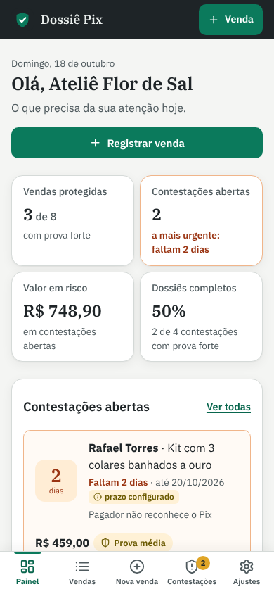 | 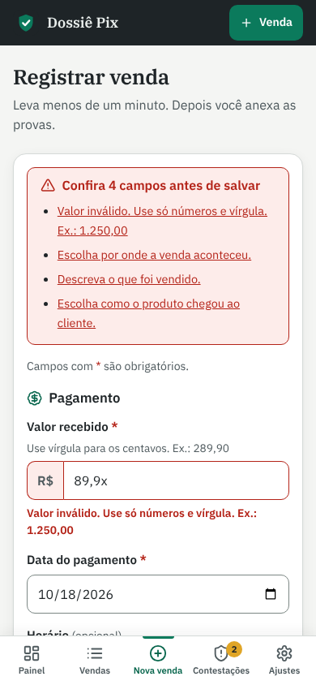 | 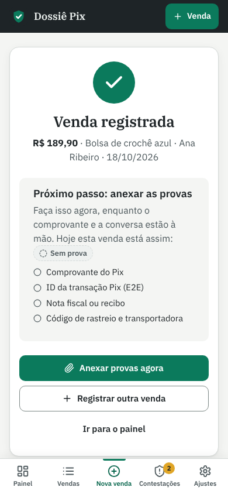 | 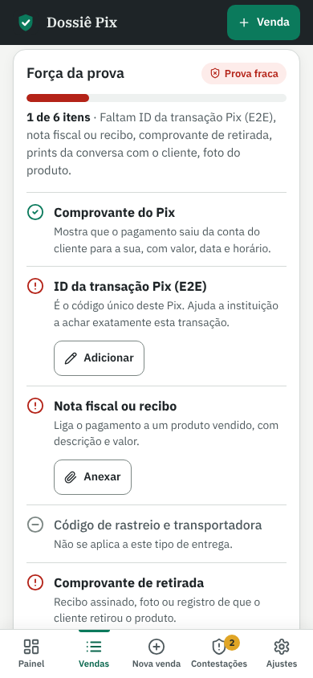 |

| Abrir contestação | Dossiê | Busca sem resultado | Histórico |
|---|---|---|---|
| 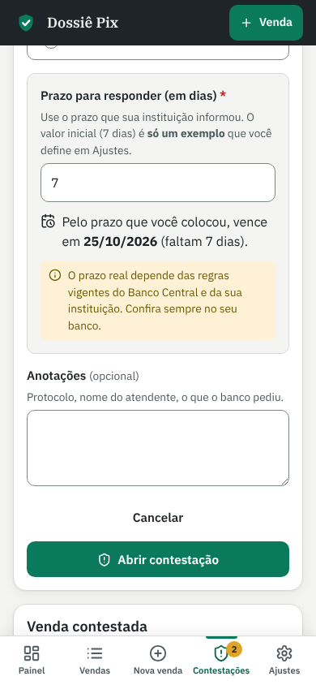 | 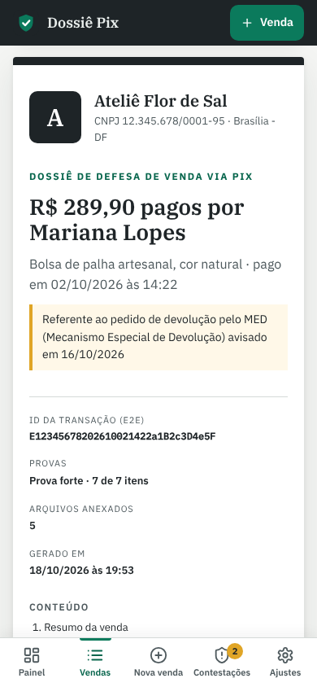 | 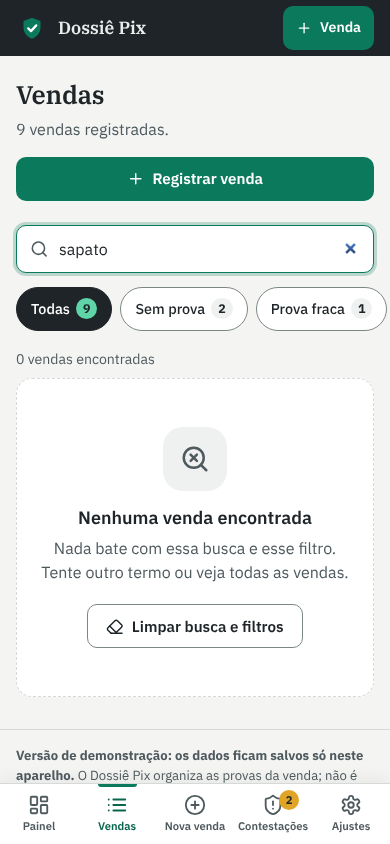 | 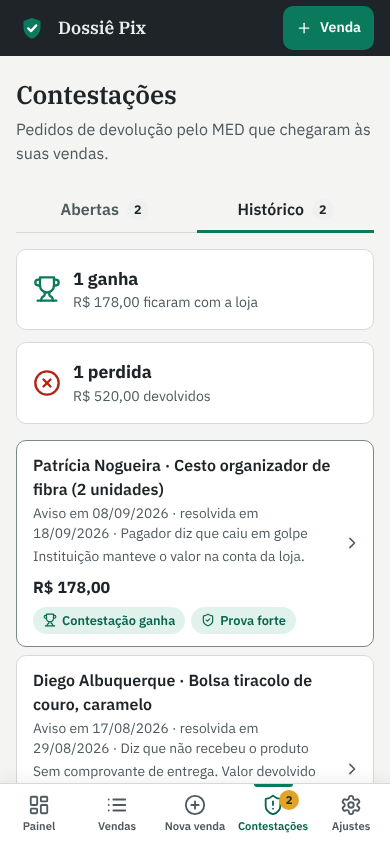 |

## Piloto automático (demonstração, 1440 x 900 e 390 x 844)

| Página de vendas | Afiliados |
|---|---|
| 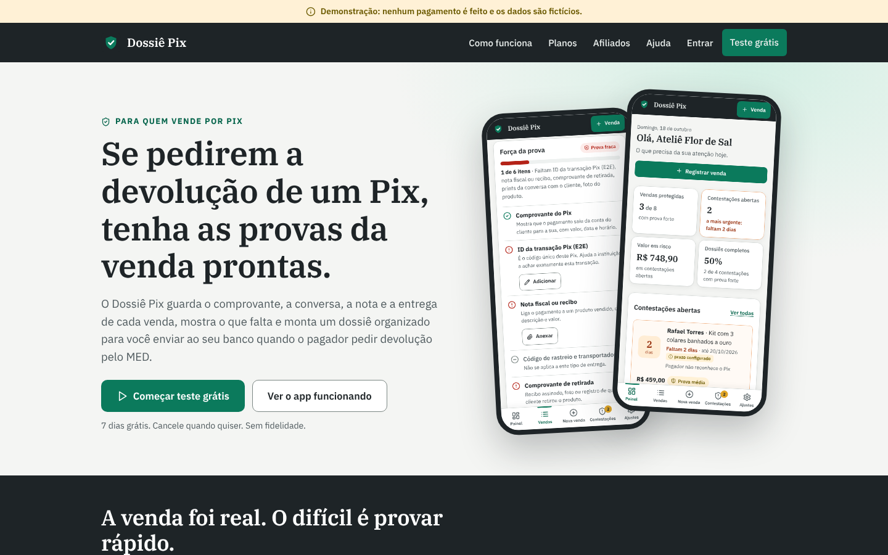 | 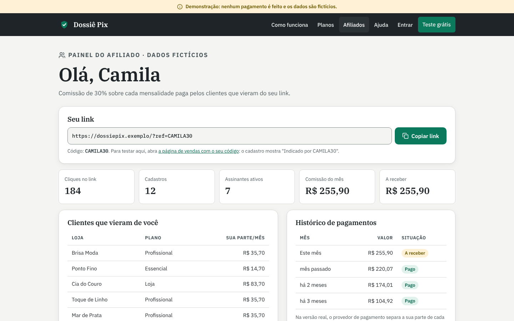 |

| Painel do dono | Painel do dono no celular |
|---|---|
| 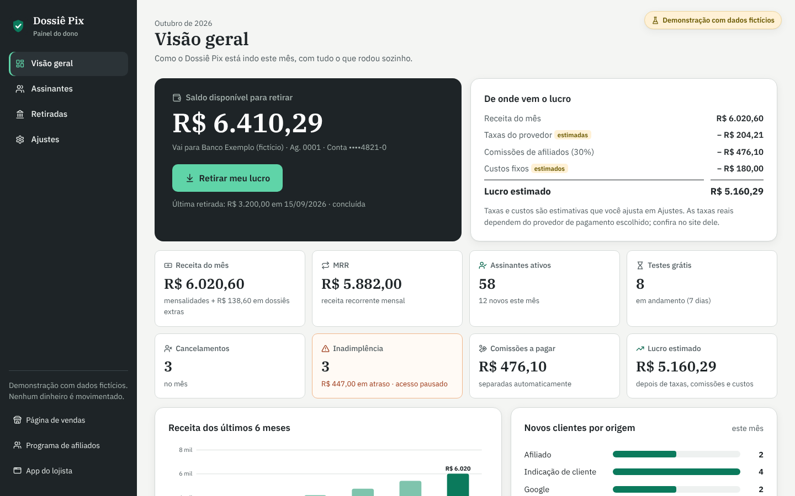 | 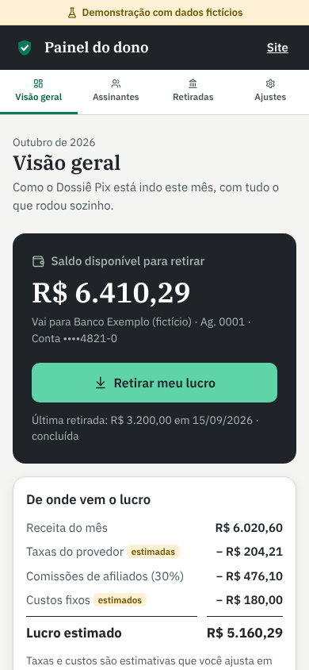 |
