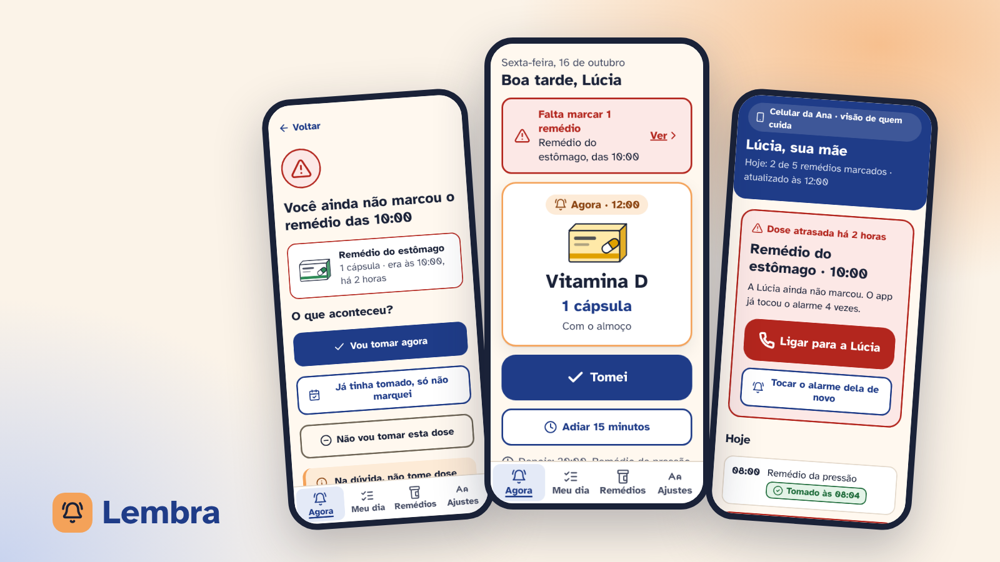

# Lembra

App mobile (iOS e Android) para pessoas idosas tomarem os remédios na hora certa, com um familiar ou cuidador acompanhando de longe. Projeto conceitual de 2026, feito por mim do começo ao fim.

**Papel:** UX/UI Designer, individual · **Métodos:** benchmark, proto-persona (hipótese), jornada, fluxos, avaliação heurística e protótipo de alta fidelidade

- [Página do projeto](https://gabriel-abreu-portfolio.vercel.app/projetos/lembra.html)
- [Protótipo navegável](https://gabriel-abreu-portfolio.vercel.app/lembra/prototipo/)
- [Documentação](docs/README.md)

**Problema:** muitos remédios em horários diferentes, letra pequena nos apps, a dúvida "já tomei ou não?" e o familiar que só descobre a dose esquecida dias depois.

**Solução:** uma tela "Agora" com o próximo remédio em letra grande e dois botões enormes (Tomei e Adiar 15 min), confirmação com desfazer, o dia dividido em manhã, tarde e noite, aviso de estoque, ajuda clara quando uma dose é esquecida e uma visão para o cuidador com a dose atrasada em destaque e o botão de ligar.

Protótipo com dados e remédios fictícios. Não é orientação médica.
