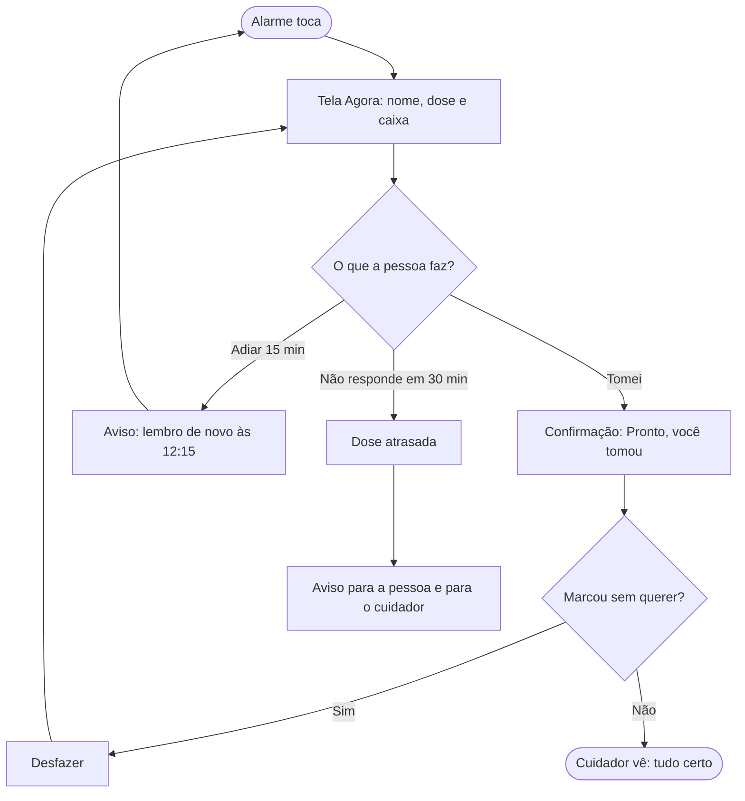
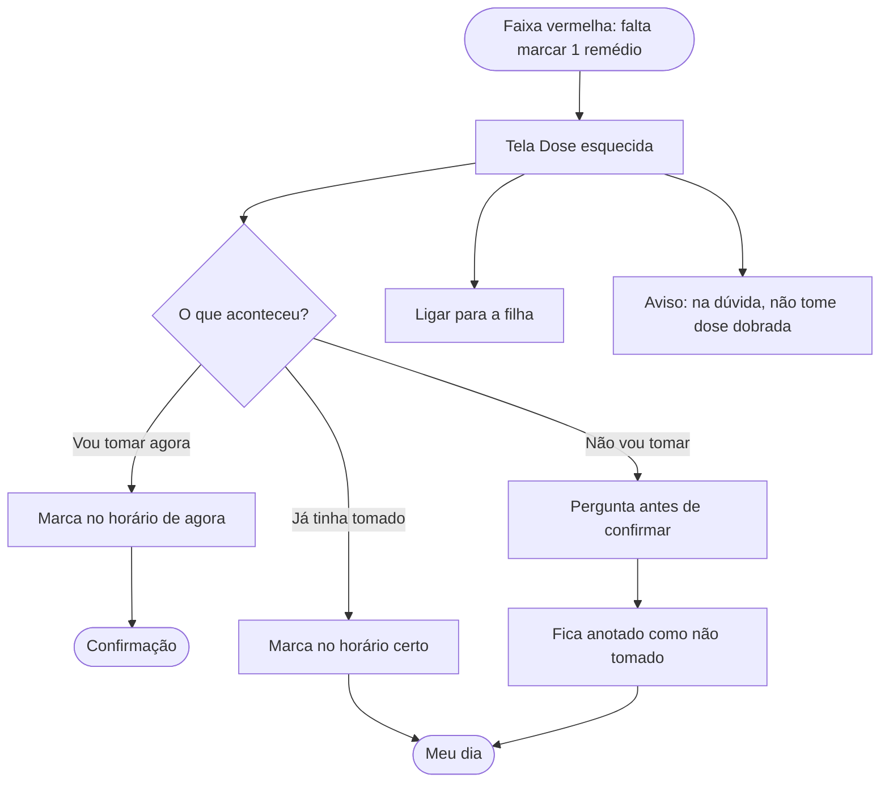
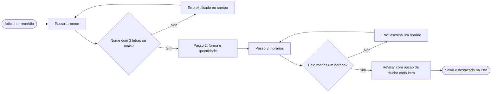
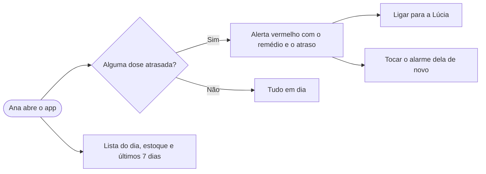

# 03 · Fluxos

## Fluxo principal: hora do remédio

## Dose esquecida

## Cadastro de remédio em passos

## Visão do cuidador

## Mapa de telas

| Aba | Telas |
|---|---|
| Agora | Agora, Confirmação "Tomei", Dose esquecida |
| Meu dia | Lista de manhã, tarde e noite, com desmarcar |
| Remédios | Lista e estoque, Cadastro em 3 passos e revisão |
| Ajustes | Tamanho da letra, contraste, alarme, quem acompanha |
| (celular do cuidador) | Visão do cuidador |
