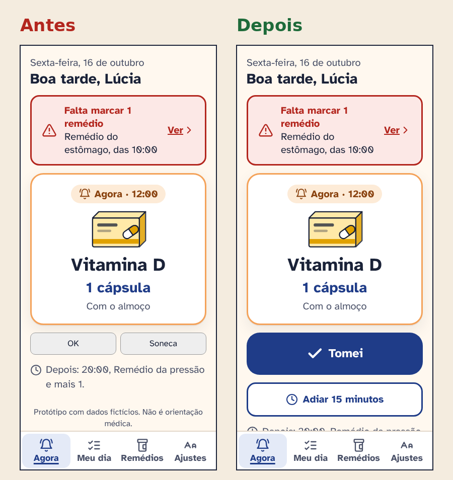

# 05 · Avaliação heurística

Avaliei o meu próprio protótipo com as 10 heurísticas de Nielsen, olhando cada tela no tamanho de letra padrão e no "Muito grande". Severidade de 1 (cosmético) a 4 (catástrofe).

**Resultado:** 9 problemas, 7 corrigidos e 2 pendentes, que dependem de teste em aparelho real ou de uma tela nova.

| # | Problema | Heurística | Severidade | Correção | Status |
|---|---|---|---|---|---|
| 1 | "OK" e "Soneca" lado a lado, do mesmo tamanho e cor. Fácil tocar no errado e "Soneca" não diz quanto tempo | 5 · Prevenção de erros | 4 | "Tomei" grande e azul em cima; "Adiar 15 minutos" com contorno, embaixo e com espaço | Corrigido |
| 2 | Não havia como desfazer "Tomei" | 3 · Controle e liberdade | 4 | Tela de confirmação com "Marquei sem querer, desfazer" e botão "Desmarcar" no Meu dia | Corrigido |
| 3 | Dose atrasada mostrada só em vermelho | 1 · Visibilidade do estado | 3 | Selo com ícone e texto "Atrasado · era 10:00" e borda mais grossa | Corrigido |
| 4 | Horário digitado em texto livre ("8h", "08:00", "8 da manhã") | 5 · Prevenção de erros | 3 | Escolha por cartões (Manhã, Almoço, Tarde, Noite) e campo de hora para outro horário | Corrigido |
| 5 | Dose esquecida só oferecia "Tomar agora", o que pode levar a dose dobrada | 9 · Reconhecer e recuperar de erros | 4 | Três opções claras, aviso "na dúvida, não tome dose dobrada" e botão para ligar para a filha | Corrigido |
| 6 | Palavras como "posologia" e "adesão" | 2 · Correspondência com o mundo real | 2 | "Quanto você toma de cada vez?" e "doses marcadas" | Corrigido |
| 7 | Tamanho de letra só nas configurações do celular, sem ver o resultado | 7 · Flexibilidade e eficiência | 2 | Ajuste dentro do app com três tamanhos e prévia ao vivo | Corrigido |
| 8 | O alarme com som e vibração não pode ser avaliado no protótipo de navegador | 1 · Visibilidade do estado | 3 | Testar em aparelho real: volume, repetição e como parar o alarme | Pendente |
| 9 | Não há explicação do que o cuidador vai ver antes de convidar alguém | 10 · Ajuda e documentação | 2 | Desenhar a tela de convite com a lista do que é compartilhado e como parar | Pendente |

## Antes e depois do problema mais grave

O problema 1 foi o mais grave porque acontece várias vezes por dia e o erro (tocar "Soneca" achando que marcou) deixa a pessoa sem saber se tomou. A correção junta três coisas: diferença de peso visual, espaço entre os botões e texto que diz exatamente o que acontece.

## Resumo por heurística

| Heurística | Problemas |
|---|---|
| 1 · Visibilidade do estado do sistema | 2 (um corrigido, um pendente) |
| 2 · Correspondência com o mundo real | 1 |
| 3 · Controle e liberdade do usuário | 1 |
| 5 · Prevenção de erros | 2 |
| 7 · Flexibilidade e eficiência de uso | 1 |
| 9 · Reconhecer, diagnosticar e recuperar de erros | 1 |
| 10 · Ajuda e documentação | 1 |

As heurísticas 4 (consistência), 6 (reconhecer em vez de lembrar) e 8 (estética e design minimalista) não geraram problemas novos nesta rodada. A regra de uma ação por tela e os mesmos selos de estado em todas as telas, inclusive na visão do cuidador, ajudaram nesses pontos.

## Como avaliei

- Passei por todas as telas do protótipo com a letra em 20px e em 28px.
- Fiz cada tarefa só com o teclado para checar foco e ordem.
- Anotei cada problema com a heurística, a severidade e uma correção possível.
- Corrigi primeiro os de severidade 4 e 3 que podiam ser resolvidos no protótipo.
