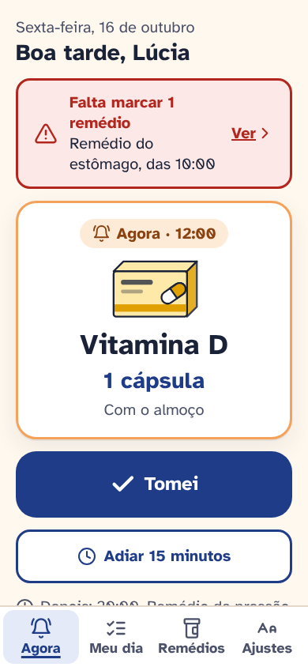
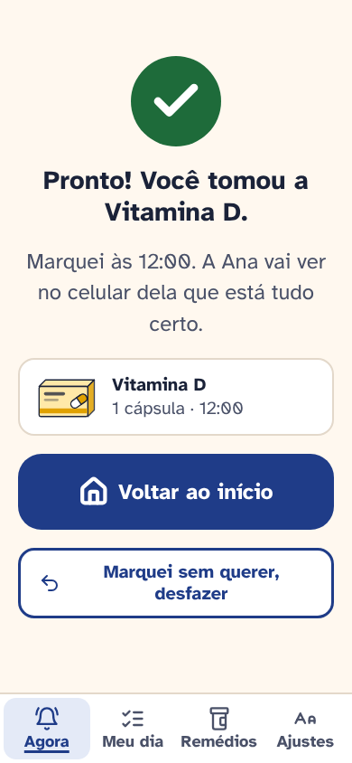
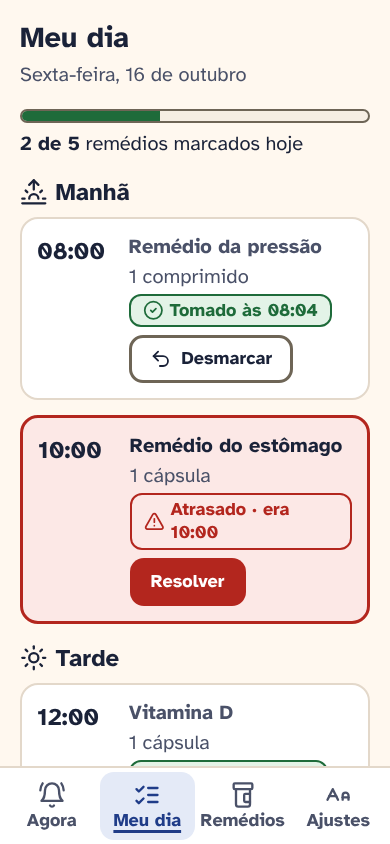
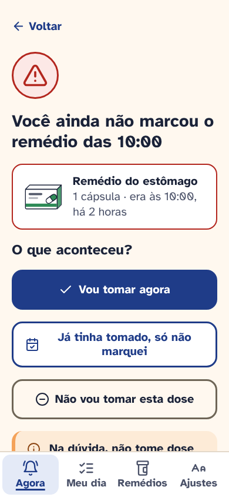
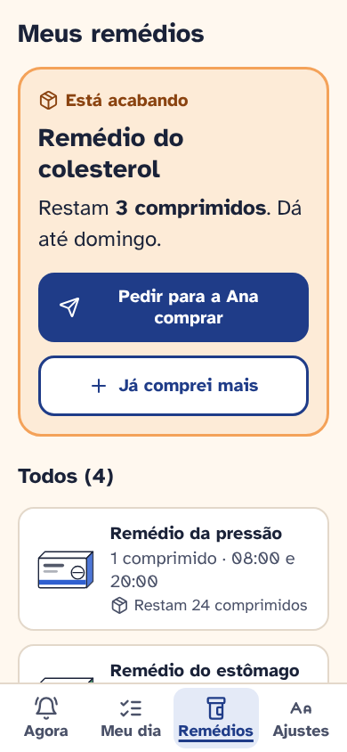
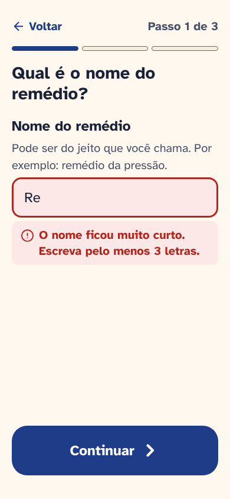
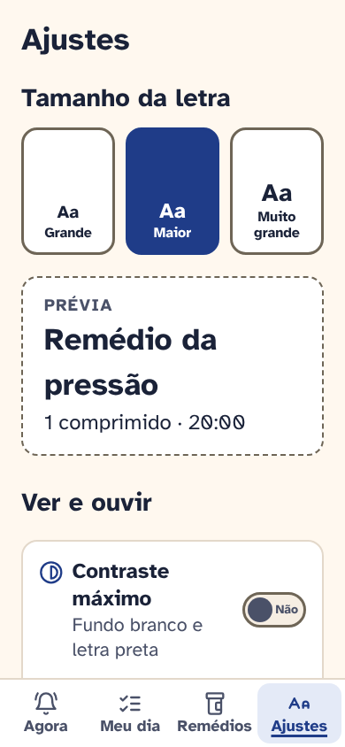
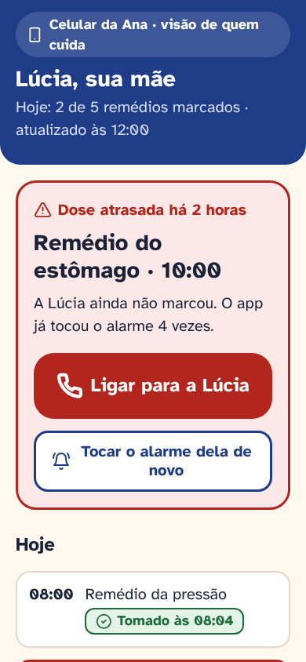

# Lembra · documentação

Projeto conceitual de 2026. Todo o trabalho é meu, feito sozinho. Os dados do protótipo são fictícios e o Lembra não dá orientação médica.

| Documento | O que tem |
|---|---|
| [01 · Problema e benchmark](01-problema-e-benchmark.md) | O problema, o objetivo e a análise de 4 produtos reais |
| [02 · Persona e jornada](02-persona-e-jornada.md) | Proto-persona (hipótese) da pessoa idosa e da cuidadora, jornada com pontos de dor |
| [03 · Fluxos](03-fluxos.md) | Fluxo principal, dose esquecida, cadastro e visão do cuidador |
| [04 · Decisões de UI](04-decisoes-de-ui.md) | Acessibilidade, paleta com contraste, tipografia e componentes |
| [05 · Avaliação heurística](05-avaliacao-heuristica.md) | 9 problemas achados no meu protótipo, 7 corrigidos |
| [06 · Próximos passos](06-proximos-passos.md) | Roteiro de teste com 5 pessoas, métricas e aprendizados |

## Prints

Telas em 390 × 844, na pasta [prints](prints/).

| Agora | Tomei | Meu dia | Dose esquecida |
|---|---|---|---|
|  |  |  |  |

| Estoque | Cadastro com erro | Tamanho da letra | Visão do cuidador |
|---|---|---|---|
|  |  |  |  |
