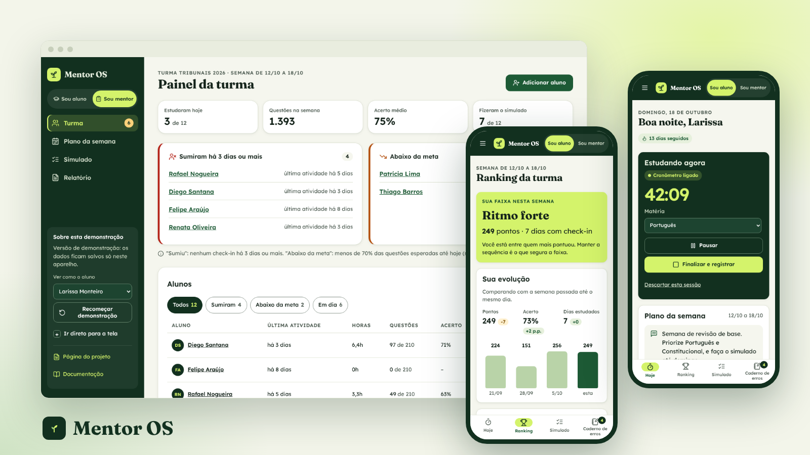

# Mentor OS

App web instalável para mentor independente de concurso público acompanhar a turma: o aluno faz check-in de estudo com cronômetro, entra num ranking que premia acertos e constância, faz um simulado relâmpago por semana e revisa um caderno de erros; o mentor vê quem sumiu, quem está abaixo da meta e manda mensagem pelo WhatsApp com um toque.

**Papel:** UX/UI Designer, projeto individual · **Tipo:** projeto conceitual, 2026 · **Métodos:** benchmark, proto-persona (hipótese), jornada, fluxos, avaliação heurística, protótipo funcional e modelo de negócio

[Página do projeto](https://gabriel-abreu-portfolio.vercel.app/projetos/mentor-os.html) · [App de demonstração](https://gabriel-abreu-portfolio.vercel.app/mentor-os/prototipo/) · [Documentação](docs/) · [Estrutura do banco](supabase/schema.sql) · [Como colocar no ar](COMO-COLOCAR-NO-AR.md)

- **Problema:** o mentor acompanha a turma por planilha e grupo de WhatsApp e só descobre que um aluno sumiu quando ele já desistiu.
- **Solução:** duas visões no mesmo app. O aluno registra o estudo pelo número de questões (não por foto); o mentor recebe alertas de "sumiu há 3+ dias" e "abaixo da meta", vê o detalhe de cada aluno e fecha a semana com um relatório pronto.
- **Resultado:** app funcional com 9 telas e dados salvos no aparelho, benchmark de 5 produtos e avaliação heurística com 8 problemas encontrados e 6 corrigidos.

Versão de demonstração: os dados ficam salvos só neste aparelho. Nomes, telefones, números e questões são fictícios.
