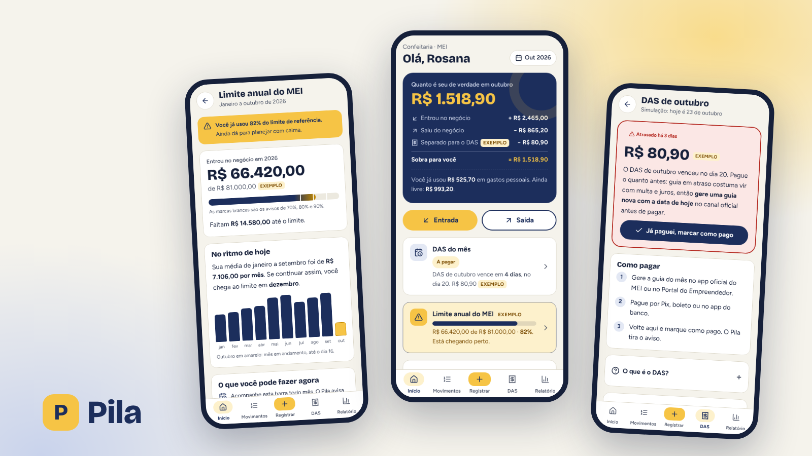

# Pila

App mobile (iOS e Android) de finanças para MEI e autônomos: separa o dinheiro do negócio do pessoal, mostra quanto realmente sobrou no mês, lembra do DAS e acompanha o limite anual do MEI.

**Papel:** UX/UI Designer, projeto individual · **Tipo:** projeto conceitual, 2026 · **Métodos:** benchmark, proto-persona (hipótese), jornada, fluxos, avaliação heurística e protótipo de alta fidelidade

[Página do projeto](https://gabriel-abreu-portfolio.vercel.app/projetos/pila.html) · [Protótipo](https://gabriel-abreu-portfolio.vercel.app/pila/prototipo/) · [Documentação](docs/)

- **Problema:** o dinheiro da empresa e o pessoal se misturam na mesma conta; a pessoa não sabe quanto lucrou, esquece o DAS e perde o controle do limite anual.
- **Solução:** uma tela inicial que responde "quanto é seu de verdade este mês", com a conta inteira à vista, registro rápido com "negócio ou pessoal", guia do DAS com lembrete e barra do limite com avisos.
- **Resultado:** protótipo navegável com 9 telas, benchmark de 5 produtos e avaliação heurística com 8 problemas encontrados e 6 corrigidos.

Dados do protótipo são fictícios. Os valores do DAS e do limite anual são exemplos, não valores oficiais.
