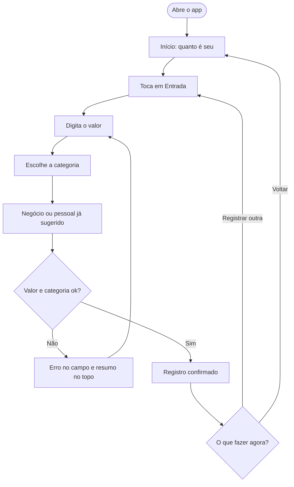
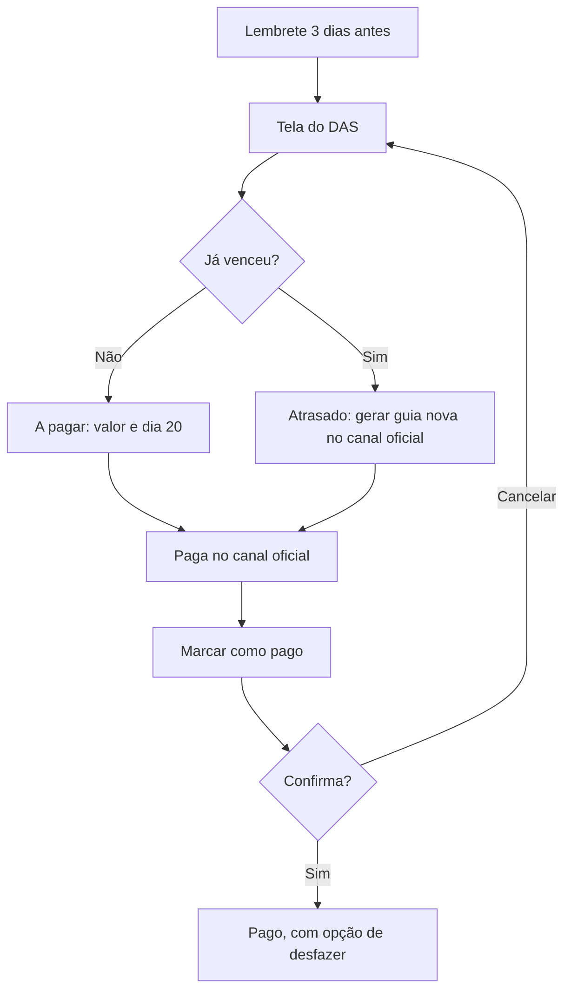

# 03 · Fluxos

## Mapa do app

- **Boas-vindas** com escolha da atividade (ajusta os nomes das categorias)
- **Início**: quanto é seu, atalhos de entrada e saída, DAS do mês, limite anual, últimas movimentações
- **Registrar**: entrada ou saída, valor, categoria, negócio ou pessoal
- **Movimentações**: lista por dia com filtros
- **DAS**: status do mês, como pagar, lembrete, histórico
- **Limite anual**: barra, ritmo do ano e avisos
- **Relatório do mês**

Barra inferior: Início, Movimentos, Registrar, DAS e Relatório. O limite anual abre pelo cartão do início.

## Fluxo principal: registrar uma entrada

## Fluxo do DAS

## Estados que desenhei

| Tela | Estados |
|---|---|
| Boas-vindas | sem atividade escolhida (erro), atividade escolhida |
| Início | primeiro uso (vazio), com dados, limite acima de 80% |
| Registrar | entrada, saída, erro de valor, erro de categoria |
| Movimentações | com dados, filtro sem resultado (vazio) |
| DAS | a pagar, em atraso, pago, confirmação |
| Limite | abaixo e acima da marca de aviso |
