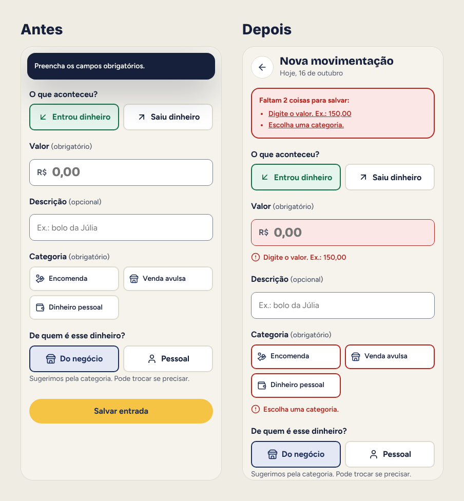

# 05 · Avaliação heurística

Avaliei a primeira versão do meu protótipo com as 10 heurísticas de Nielsen, passando por todas as telas e estados. Severidade de 1 (cosmético) a 4 (catastrófico).

Fiz a avaliação sozinho, em duas passadas: uma pelo fluxo principal (registrar e ver o quanto sobra) e outra pelos estados de erro, vazio, atraso e confirmação.

**Resultado:** 8 problemas encontrados, 6 corrigidos nesta versão e 2 deixados para a próxima.

| # | Problema | Heurística | Severidade | Correção | Status |
|---|---|---|---|---|---|
| 1 | Valores do DAS e do limite pareciam oficiais | H2 Correspondência com o mundo real | 3 | Selo "exemplo" em todo valor de DAS e limite, e aviso para conferir no canal oficial | Corrigido |
| 2 | Erro de valor aparecia só num aviso no topo que sumia, sem marcar o campo | H9 Ajudar a reconhecer e corrigir erros | 3 | Mensagem no próprio campo, borda e fundo de erro, resumo com links e foco no primeiro erro | Corrigido |
| 3 | "Marcar DAS como pago" mudava o status num toque, sem volta | H3 Controle e liberdade | 3 | Diálogo de confirmação e botão "Desfazer" no aviso e na tela | Corrigido |
| 4 | "Sobra para você" mostrava só o resultado, sem a conta | H6 Reconhecer em vez de lembrar | 2 | A conta aparece inteira no cartão: entrou, saiu, DAS e sobra | Corrigido |
| 5 | Filtro sem resultado deixava a tela em branco | H1 Visibilidade do estado do sistema | 2 | Contador de resultados e estado vazio com "Limpar filtros" | Corrigido |
| 6 | Toda vez era preciso escolher "negócio ou pessoal" do zero | H7 Flexibilidade e eficiência | 2 | A categoria sugere o escopo; a pessoa só troca se precisar | Corrigido |
| 7 | Não dá para editar nem excluir uma movimentação | H3 Controle e liberdade | 3 | Abrir o item da lista com opções de editar e excluir | Pendente |
| 8 | Relatório não pode ser enviado ao contador | H7 Flexibilidade e eficiência | 1 | Botão para compartilhar o resumo do mês em PDF | Pendente |

## Antes e depois: erro no valor

**Antes:** ao salvar sem valor, só aparecia "Preencha os campos obrigatórios" no topo. O aviso sumia e a pessoa não sabia qual campo faltava.

**Depois:** o campo fica marcado, a mensagem diz o que fazer ("Digite o valor. Ex.: 150,00"), o resumo no topo lista o que falta com links, e o foco vai direto para o campo.

## Por que os pendentes ficaram para depois

- **Editar e excluir (7)** é grave, mas depende de decidir como lidar com registros que já entraram no limite anual. Prefiro testar com usuários antes.
- **Enviar ao contador (8)** é útil, mas não bloqueia a tarefa principal.
