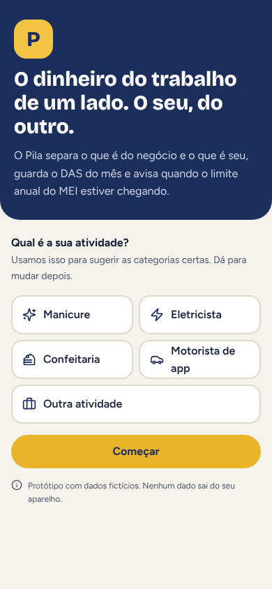
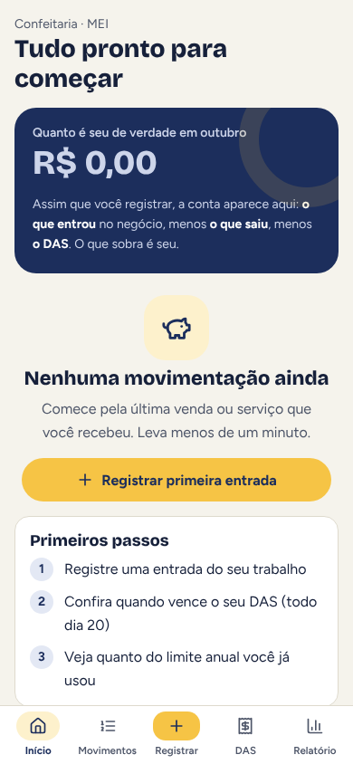
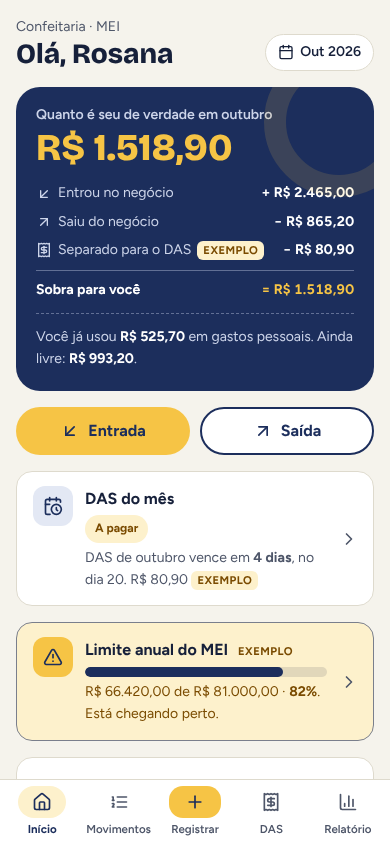
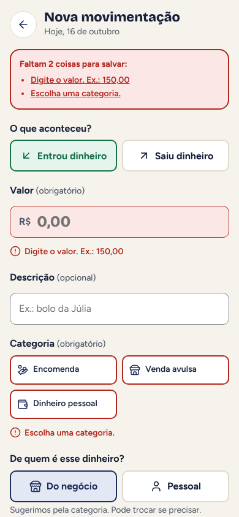
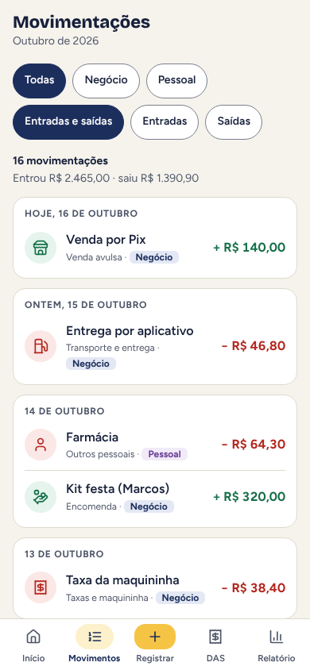
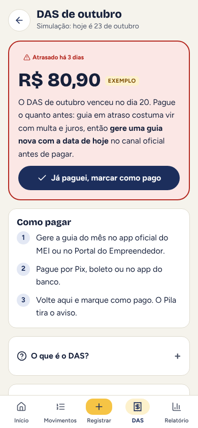
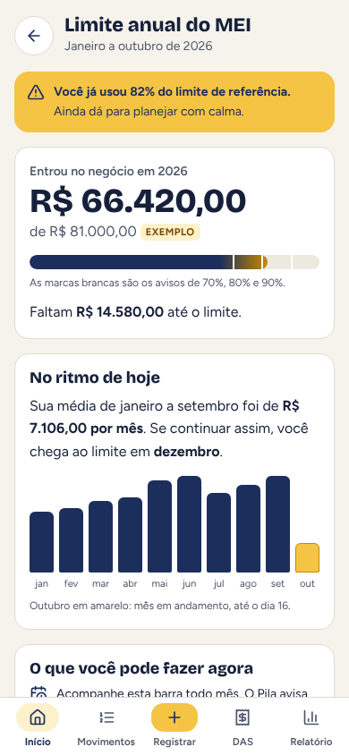
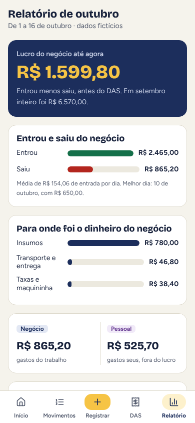

# Pila · documentação

Projeto conceitual de 2026, feito por mim do começo ao fim: pesquisa por benchmark, proto-persona, fluxos, interface, avaliação heurística e protótipo navegável.

O Pila é um app mobile (iOS e Android) de finanças para MEI e autônomos: manicure, eletricista, confeiteira, motorista de app. Ele separa o dinheiro do negócio do dinheiro pessoal, mostra quanto realmente sobrou no mês, lembra do DAS e acompanha o limite de faturamento anual do MEI.

> Todos os dados do protótipo são fictícios. Os valores do DAS e do limite anual aparecem como **exemplo** e não são valores oficiais. Os valores oficiais devem ser conferidos nos canais do governo.

## Índice

1. [Problema e benchmark](01-problema-e-benchmark.md)
2. [Proto-persona e jornada](02-persona-e-jornada.md) (hipótese, ainda não validada)
3. [Fluxos](03-fluxos.md)
4. [Decisões de UI](04-decisoes-de-ui.md): paleta com contraste, tipografia e componentes
5. [Avaliação heurística](05-avaliacao-heuristica.md): 8 problemas, 6 corrigidos
6. [Próximos passos](06-proximos-passos.md): roteiro de teste com 5 pessoas, métricas e aprendizados

## Links

- [Página do projeto](https://gabriel-abreu-portfolio.vercel.app/projetos/pila.html)
- [Protótipo navegável](https://gabriel-abreu-portfolio.vercel.app/pila/prototipo/)

## Telas (390 x 844)

| Boas-vindas | Primeiro uso | Início | Registro com erro |
|---|---|---|---|
|  |  |  |  |

| Movimentações | DAS em atraso | Limite anual | Relatório |
|---|---|---|---|
|  |  |  |  |
