# Roxx Energy

App mobile para quem tem carro elétrico achar um carregador **livre, funcionando e compatível**, reservar a vaga e pagar a recarga no mesmo lugar.

**Papel:** UX/UI Designer, projeto individual · **Tipo:** projeto conceitual, app iOS e Android · **Métodos:** benchmark, proto-persona, jornada, fluxos, wireframes, avaliação heurística e protótipo de alta fidelidade

[Estudo de caso](https://gabrielabreu-it.github.io/projetos/roxx-energy/) · [Protótipo](https://gabrielabreu-it.github.io/projetos/roxx-energy/prototipo/) · [Design system](https://gabrielabreu-it.github.io/projetos/roxx-energy/design-system/) · [Wireframes](https://gabrielabreu-it.github.io/projetos/roxx-energy/docs/wireframes/) · [Documentação completa](docs/)

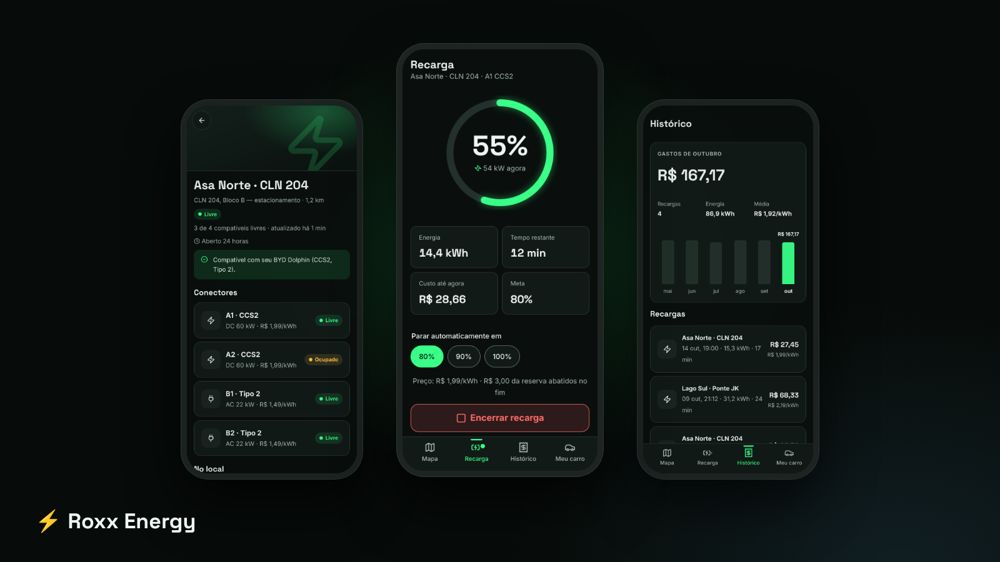

## Resumo

- **Problema:** o motorista sai de casa sem saber se o carregador vai estar livre, funcionando e compatível.
- **Solução:** mapa já filtrado pelo carro, status com a hora da atualização e relatos de outros motoristas, reserva com 15 minutos de tolerância (AC e DC), recarga acompanhada ao vivo e pagamento com Pix ou cartão.
- **Resultado:** protótipo navegável com 11 telas e os estados de erro, design system com 8 componentes, benchmark de 5 produtos e avaliação heurística com 8 problemas encontrados e 6 corrigidos.

## Problema

Quem tem carro elétrico no Brasil sai de casa sem saber se o carregador vai estar **livre**, **funcionando** e **compatível** com o carro. Na prática usa mais de um app, liga para o estabelecimento ou só descobre quando chega.

**Objetivo:** achar, em menos de um minuto, um carregador livre, funcionando e compatível, garantir a vaga e pagar sem sair do app.

## Processo

1. **Benchmark** de PlugShare, Tupi (antiga Tupinambá Energia), Zletric, EZVolt e Shell Recharge, com tabela de funcionalidades, pontos fortes e falhas → [docs/01](docs/01-problema-e-benchmark.md)
2. **Proto-persona** (hipótese, ainda não validada) e **jornada** com pontos de dor → [docs/02](docs/02-persona-e-jornada.md)
3. **Arquitetura de informação e fluxos** → [docs/03](docs/03-arquitetura-e-fluxos.md)
4. **Wireframes** de baixa fidelidade das 8 telas principais → [docs/wireframes](docs/wireframes/index.html)
5. **Decisões de UI e acessibilidade**, com contraste WCAG AA calculado → [docs/04](docs/04-decisoes-de-ui-e-acessibilidade.md)
6. **Avaliação heurística** do meu protótipo, com antes e depois: 8 achados, 6 corrigidos → [docs/05](docs/05-avaliacao-heuristica.md)
7. **Roteiro de teste de usabilidade** (próximo passo) → [docs/06](docs/06-roteiro-de-teste.md)
8. **Próximos passos, métricas de sucesso e aprendizados** → [docs/07](docs/07-proximos-passos.md)

### O que levei do benchmark

| Observação | Decisão no Roxx |
|---|---|
| Status sem data de atualização não passa confiança | Todo status mostra há quantos minutos foi atualizado |
| A checagem de plugue depende de o usuário ligar o filtro | O carro é cadastrado no onboarding e o filtro já vem ligado |
| Reserva só para AC deixa de fora o caso mais disputado | Reserva para AC e DC, com 15 min de tolerância |
| Pagamento espalhado em apps diferentes | Reservar, carregar e pagar no mesmo app, com Pix e cartão |

### Fluxo principal

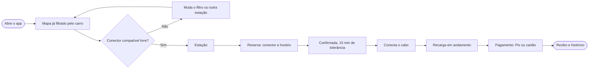

## Telas

| Onboarding | Cadastro do carro | Mapa e filtros | Estação |
|---|---|---|---|
| 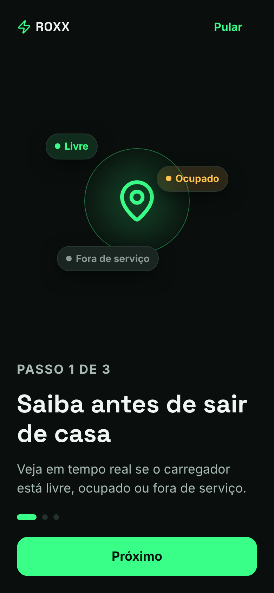 | 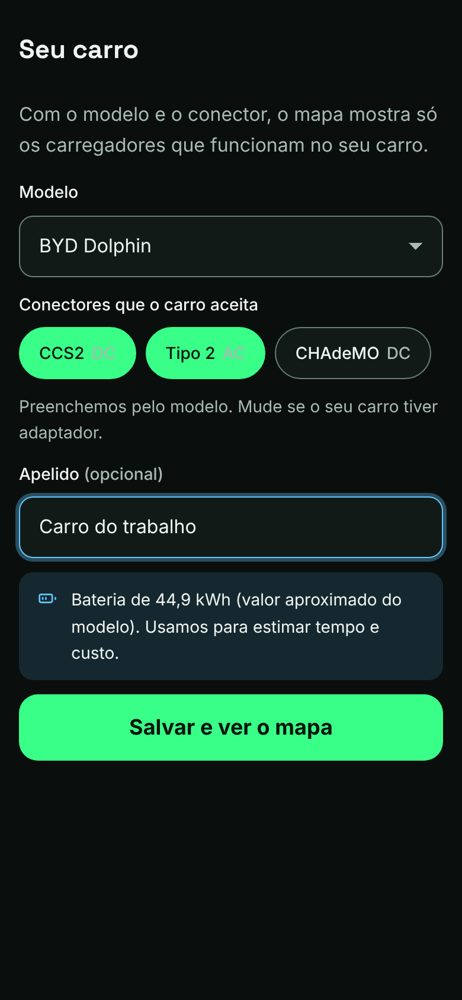 | 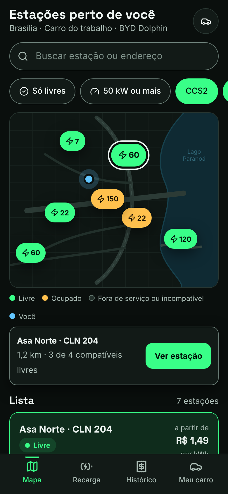 | 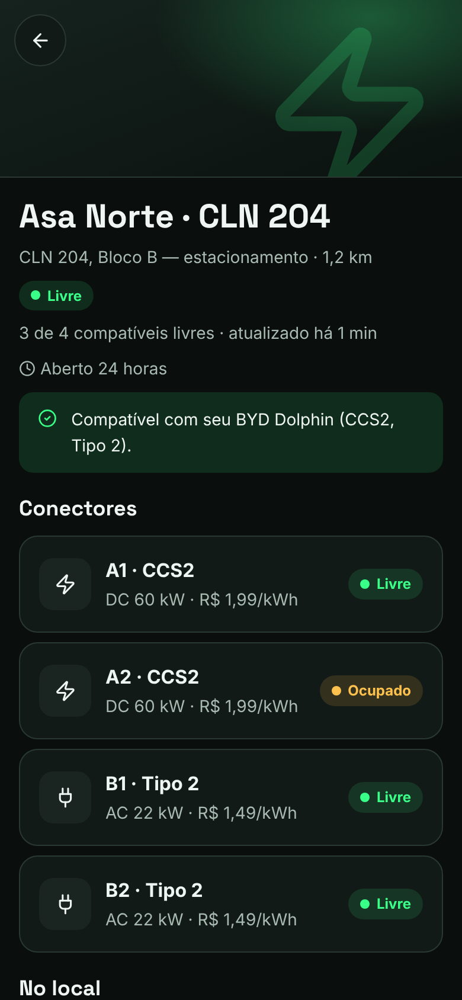 |

| Reserva | Reserva confirmada | Recarga em andamento | Encerrar |
|---|---|---|---|
| 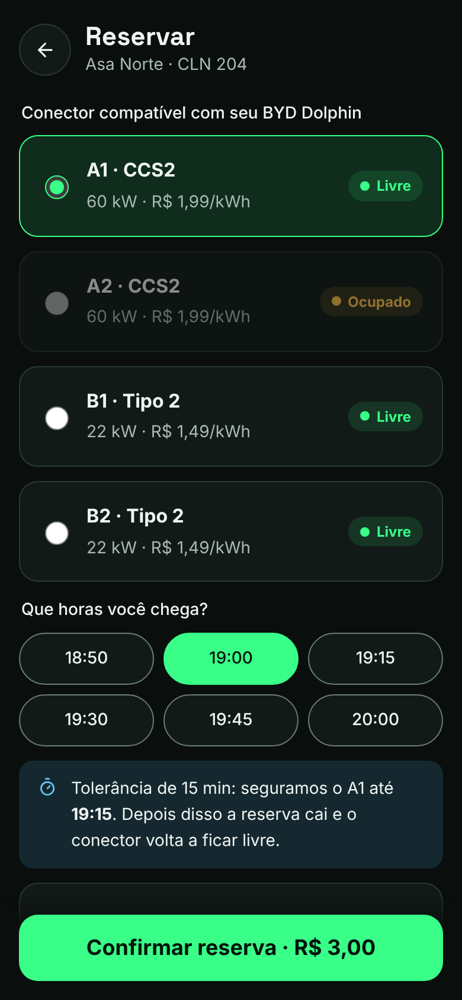 | 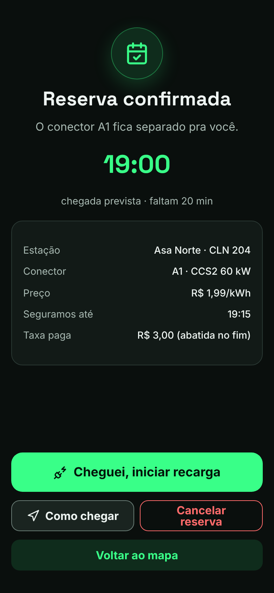 | 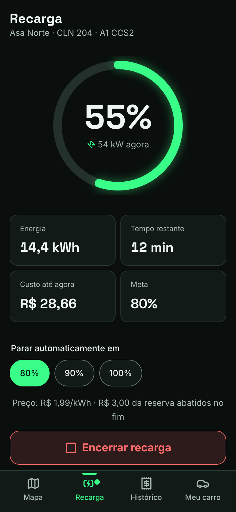 | 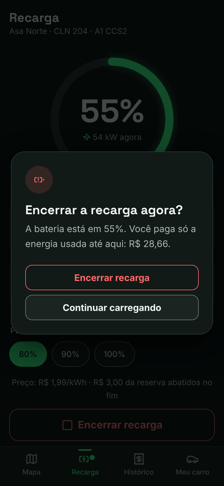 |

| Relatos na estação | Reportar problema | | |
|---|---|---|---|
| 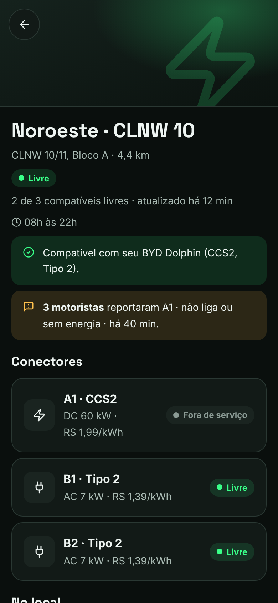 | 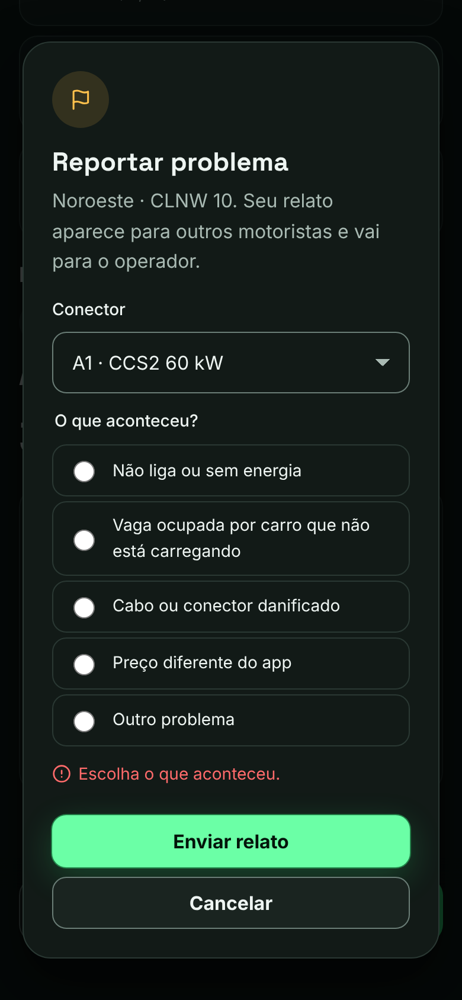 | | |

| Pagamento Pix | Recibo | Histórico | Erro no cadastro |
|---|---|---|---|
| 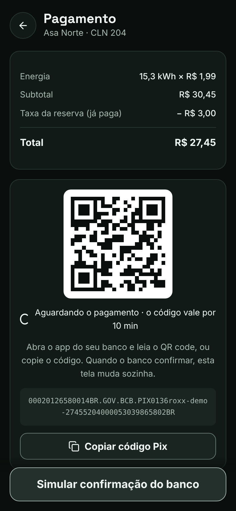 | 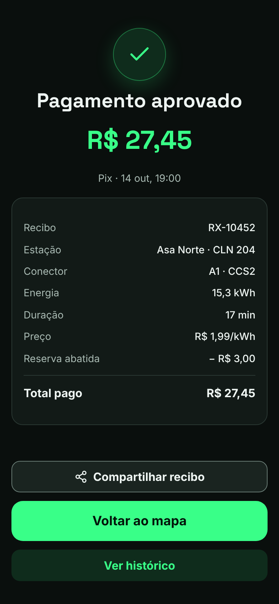 | 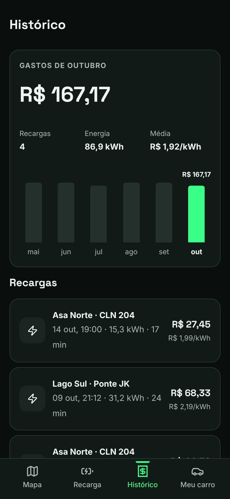 | 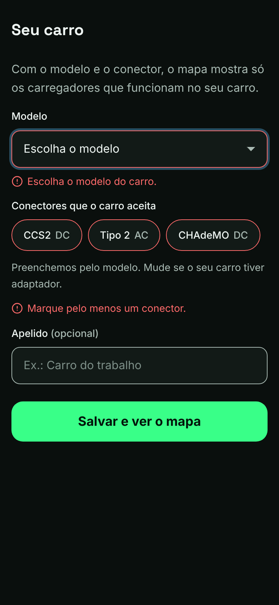 |

No desktop o protótipo aparece dentro de uma moldura de celular, com atalhos para cada tela:

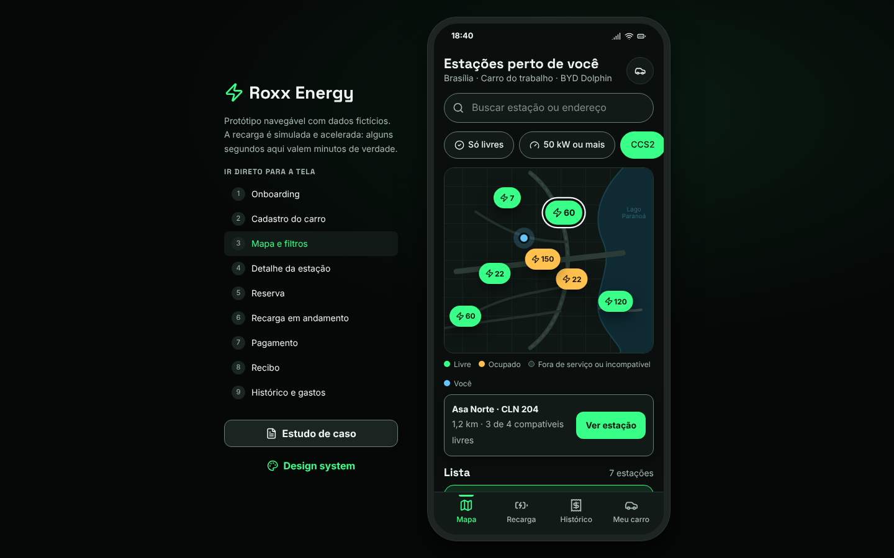

Design system e estudo de caso:

| Design system | Estudo de caso |
|---|---|
| 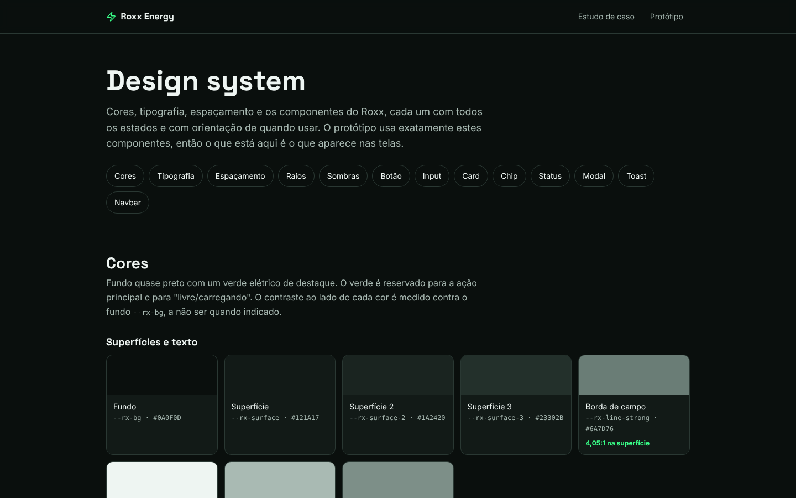 | 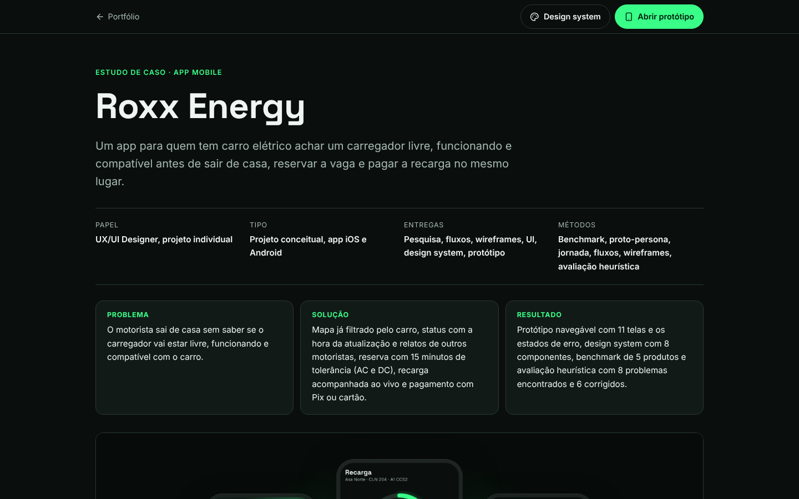 |

## Acessibilidade

- Contraste AA calculado para todos os pares de cor (texto principal 17,46:1, verde sobre fundo 14,57:1).
- Foco visível, alvos de 44px, labels em todos os campos, erros ligados ao campo.
- Fluxo inteiro pelo teclado; o modal mantém o foco e fecha com Esc.
- A recarga anuncia o progresso para leitor de tela a cada 10%.

## Estrutura

```
roxx-energy/
├── index.html          estudo de caso
├── prototipo/          protótipo de alta fidelidade
├── design-system/      cores, tipografia, espaçamento e componentes com todos os estados
└── docs/               pesquisa, fluxos, wireframes e prints
```

Dados do protótipo são fictícios. A recarga é simulada e acelerada.
