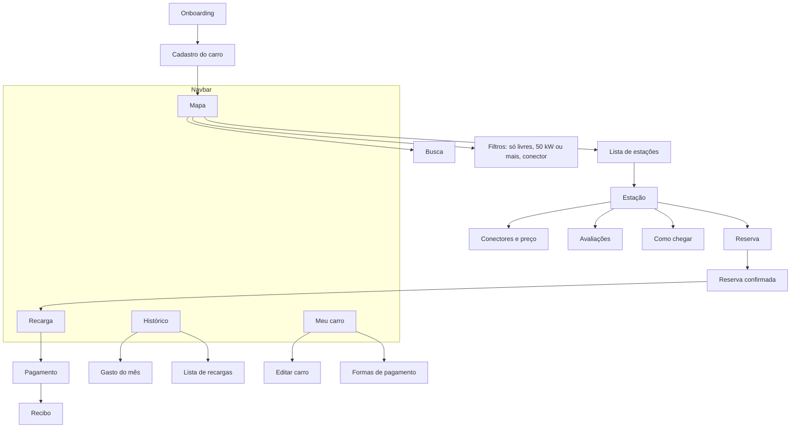
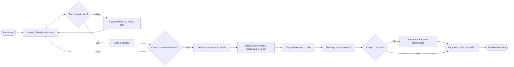
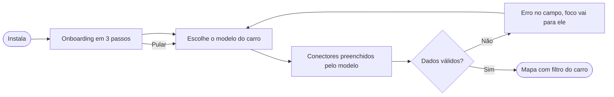
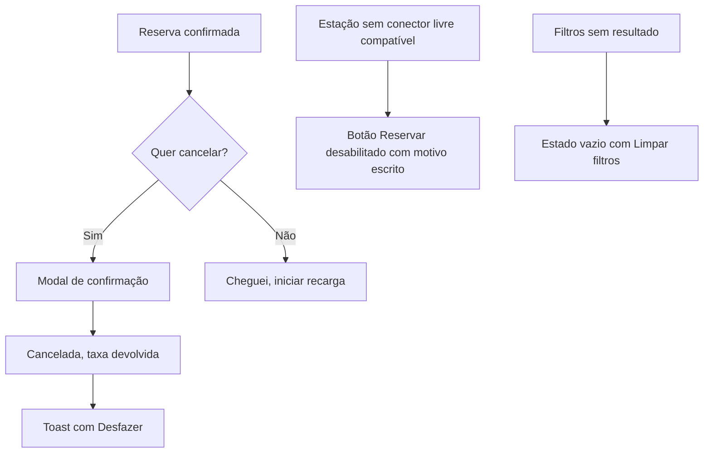

# 3. Arquitetura de informação e fluxos

[← Voltar ao índice](README.md)

## Arquitetura de informação

Quatro áreas na barra inferior. O mapa é a tela inicial porque a primeira pergunta do motorista é sempre "onde eu carrego?".

## Fluxo principal: achar, reservar, carregar e pagar

## Primeiro acesso

## Caminhos alternativos e erros

