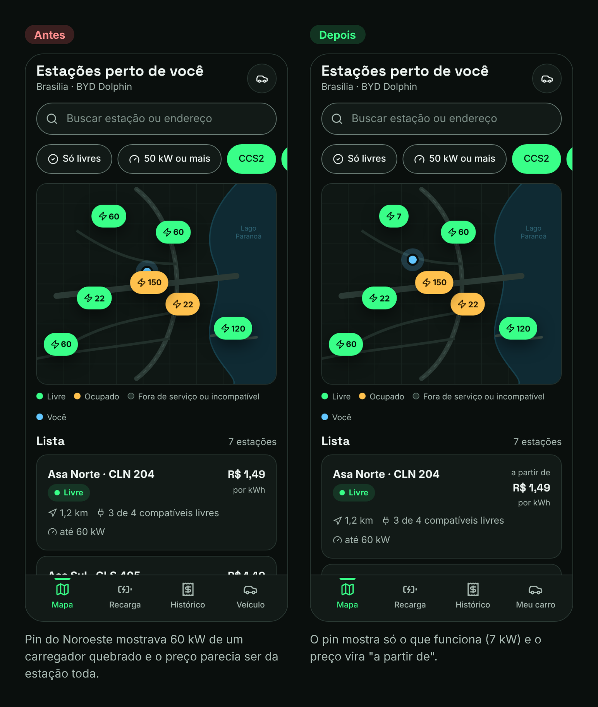
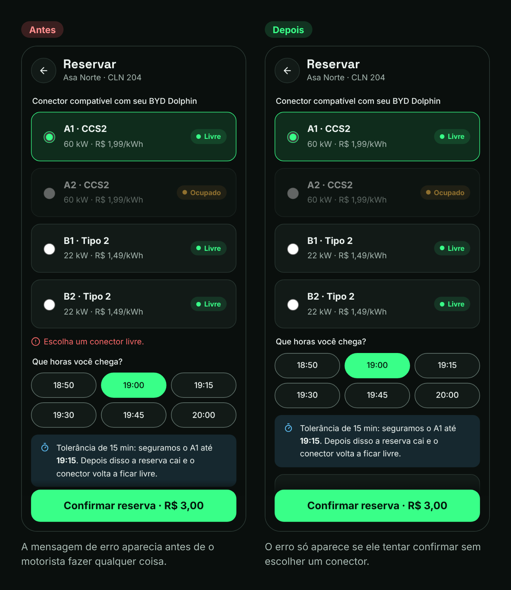
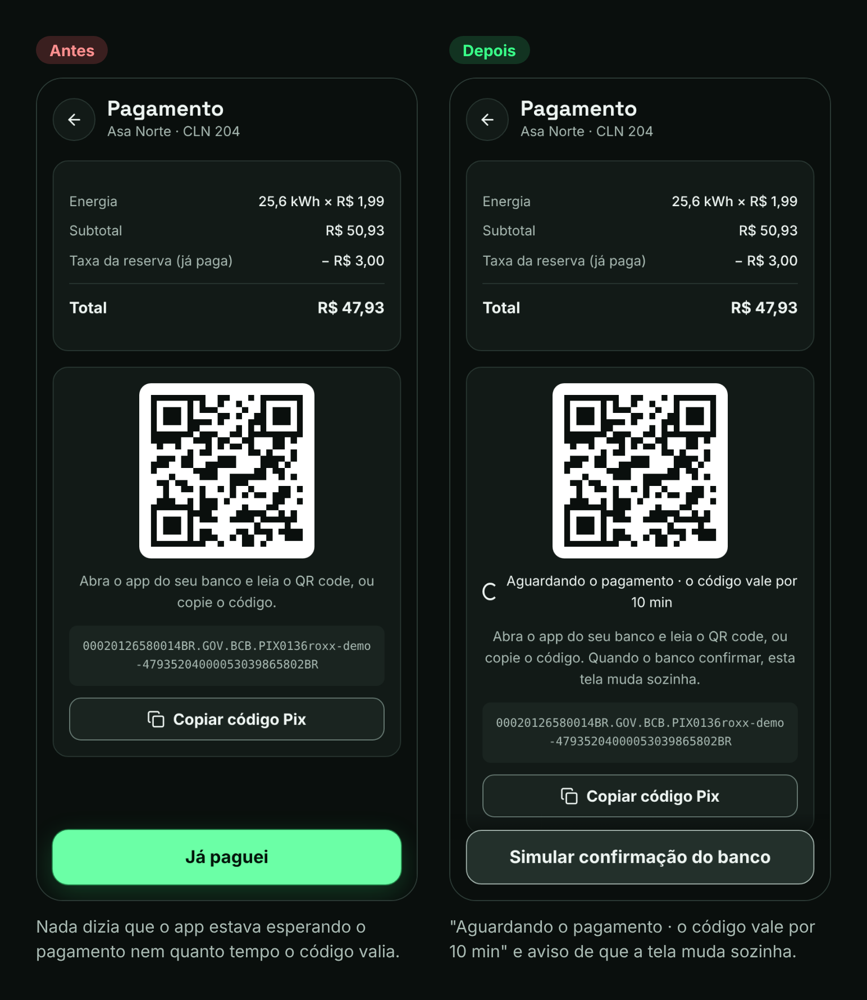

# 5. Avaliação heurística

[← Voltar ao índice](README.md)

Depois de montar o protótipo, passei por todas as telas com as 10 heurísticas de Nielsen. Avaliei sozinho, então isso não substitui teste com usuário: serve para pegar os problemas mais óbvios antes de chamar alguém.

Gravidade na escala do Nielsen: **0** não é problema · **1** cosmético · **2** pequeno · **3** grande · **4** catástrofe.

| # | Heurística | O que encontrei | Grav. | O que fiz |
|---|---|---|---|---|
| 1 | Visibilidade do status do sistema | O pin da estação do Noroeste mostrava "60 kW", mas o carregador de 60 kW estava fora de serviço. Só os de 7 kW funcionavam. | 3 | O número do pin agora considera só conectores compatíveis que estão funcionando. |
| 1 | Visibilidade do status do sistema | Na tela do Pix não havia nenhum sinal de que o app estava esperando o pagamento, nem de quanto tempo o código valia. | 2 | Adicionei "Aguardando o pagamento · o código vale por 10 min" e o aviso de que a tela muda sozinha quando o banco confirmar. |
| 2 | Correspondência com o mundo real | O card da estação mostrava "R$ 1,49 por kWh", mas esse era o preço do conector mais barato (AC). Quem olha entende que é o preço da estação toda. | 2 | Agora aparece "a partir de R$ 1,49". O preço de cada conector está na tela da estação. |
| 3 | Controle e liberdade | Conferi: dá para voltar de todas as telas, cancelar a reserva tem "Desfazer" e encerrar a recarga pede confirmação. | 0 | Nada a corrigir. |
| 4 | Consistência e padrões | A mesma coisa tinha três nomes: "Veículo" na barra, "Seu carro" no cadastro e "Trocar veículo" no botão do mapa. | 1 | Padronizei em "carro": aba "Meu carro", botões "Editar carro" e "Trocar carro". |
| 5 | Prevenção de erros | Conferi: "Reservar" fica desabilitado quando não tem conector compatível livre, com o motivo escrito. Na recarga, metas abaixo da carga atual ficam desabilitadas. | 0 | Nada a corrigir. |
| 6 | Reconhecer em vez de lembrar | Conferi: a aba Recarga mostra a reserva ativa com horário e prazo, sem o usuário precisar lembrar onde reservou. | 0 | Nada a corrigir. |
| 7 | Flexibilidade e eficiência | Quem carrega sempre no mesmo lugar precisa repetir o caminho mapa → estação → reserva toda vez. | 1 | Não corrigi agora. Está nos próximos passos (favoritos e "carregar de novo"). |
| 8 | Estética e design minimalista | O ponto azul de "Você está aqui" ficava escondido atrás de um pin no mapa. | 1 | Mudei a posição e coloquei o ponto acima do mapa, sem bloquear o clique nos pins. |
| 9 | Reconhecer, diagnosticar e corrigir erros | As mensagens de erro do cadastro e da reserva apareciam antes de o motorista fazer qualquer coisa, como se ele já tivesse errado. | 3 | O erro só aparece depois de tentar avançar, ao lado do campo com problema. |
| 10 | Ajuda e documentação | Quem nunca carregou não sabe o que é CCS2 ou CHAdeMO. Hoje só existe a dica "preenchemos pelo modelo". | 1 | Não corrigi agora. Próximos passos: um "o que é isso?" ao lado dos conectores. |

## Resumo

- 8 achados no total. Em 3 das 10 heurísticas não encontrei problema.
- 6 corrigidos no protótipo, 2 foram para os próximos passos.
- Os dois mais graves (gravidade 3) eram exatamente sobre o problema central do produto: confiar na informação do carregador e entender o que deu errado.

## Antes e depois

