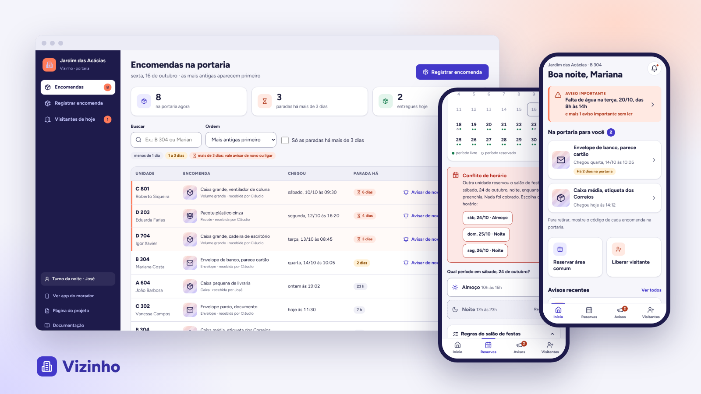

# Vizinho

App do morador e painel da portaria para condomínios residenciais. O **morador** sabe na hora que chegou encomenda e retira com um código, reserva o salão sem conflito de horário e recebe os avisos importantes separados do resto. O **porteiro** registra a encomenda em poucos toques e vê há quanto tempo cada uma está parada.

**Papel:** UX/UI Designer, projeto individual · **Tipo:** projeto conceitual de 2026, app mobile + painel web · **Métodos:** benchmark, proto-persona (hipótese), jornada, fluxos, avaliação heurística e protótipo de alta fidelidade

- [Página do projeto](https://gabriel-abreu-portfolio.vercel.app/projetos/vizinho.html)
- [Protótipo navegável](https://gabriel-abreu-portfolio.vercel.app/vizinho/prototipo/) (app do morador e painel da portaria)
- [Documentação do processo](docs/README.md)

## Estrutura

- `prototipo/index.html` entrada, com a escolha entre as duas interfaces
- `prototipo/morador/` app do morador (celular)
- `prototipo/portaria/` painel da portaria (computador, funciona no celular)
- `prototipo/shared/` cores, componentes e dados fictícios usados pelas duas
- `docs/` pesquisa, persona, fluxos, decisões de UI, avaliação heurística e prints

Dados fictícios. O que a portaria registra aparece no app do morador, no mesmo navegador.
