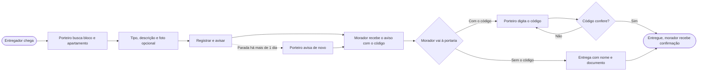
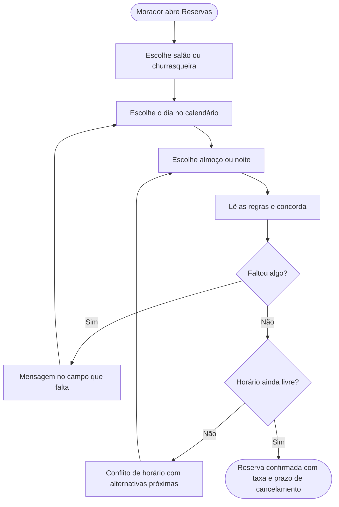
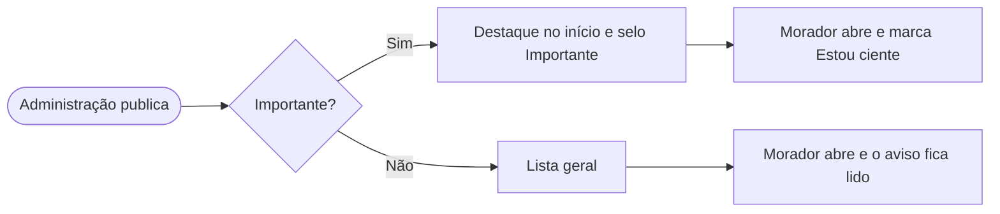
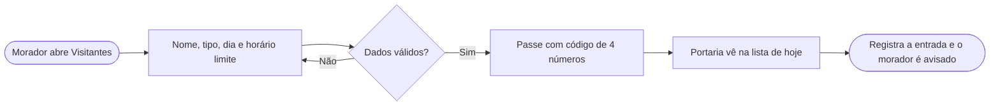

# 3. Fluxos

[← Voltar ao índice](README.md)

O ponto central do Vizinho é a encomenda passando da portaria para o morador. Os dois lados olham para o mesmo registro: o que o porteiro salva aparece no app na hora, e o que ele entrega some da tela inicial do morador.

## Encomenda: da chegada à retirada

## Reserva de área comum

O calendário já mostra o que está ocupado, então o conflito só acontece quando outra unidade reserva o mesmo período enquanto a pessoa preenche. No protótipo isso está simulado no sábado, 24/10, à noite, no salão de festas.

## Avisos

## Visitante

## Mapa das telas

| App do morador | Painel da portaria |
|---|---|
| Início · Detalhe da encomenda | Encomendas na portaria (com o diálogo de entrega) |
| Reservar · Conflito · Reserva confirmada | Registrar encomenda |
| Avisos | Visitantes de hoje |
| Liberar visitante | |
