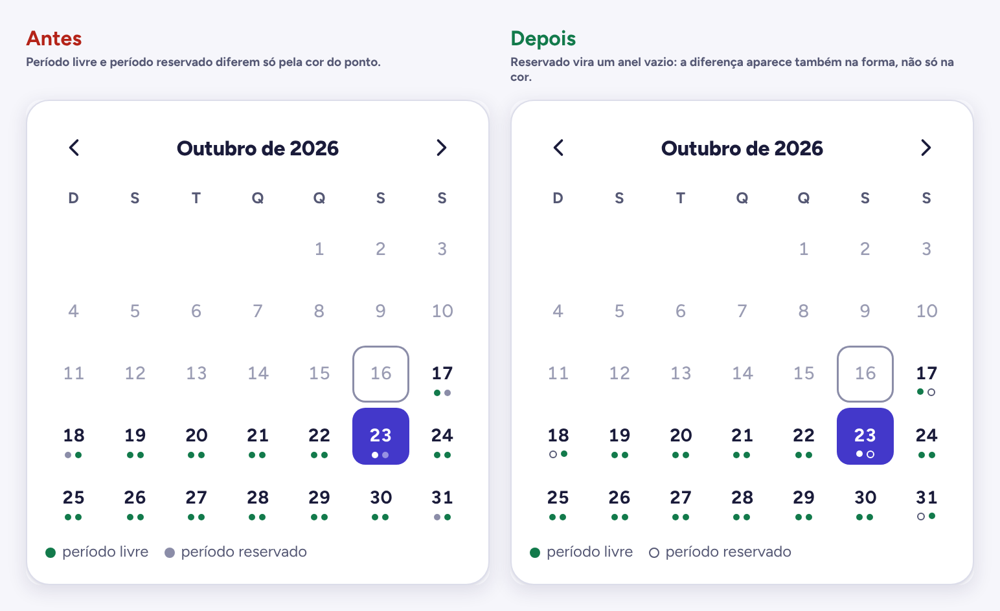

# 5. Avaliação heurística

[← Voltar ao índice](README.md)

Com as duas interfaces prontas, passei por todas as telas usando as 10 heurísticas de Nielsen. Avaliei sozinho: serve para tirar os problemas óbvios antes do teste com usuários, não para substituí-lo.

Severidade na escala de Nielsen: **1** cosmético · **2** pequeno · **3** grande · **4** catástrofe.

| # | Problema | Heurística | Sev. | Correção | Status |
|---|---|---|---|---|---|
| 1 | Liberar visitante "para hoje" deixava escolher "até 12h" ou "até 18h" às 18h40. O passe nascia vencido e a pessoa seria barrada na portaria. | 5. Prevenção de erros | 3 | Horários que já passaram ficam desativados com "(já passou)" e o formulário recusa um horário vencido com mensagem no campo. | Corrigido |
| 2 | No calendário de reserva, período livre e reservado eram dois pontos que só mudavam de cor (verde e cinza). Quem não distingue bem as cores precisava decorar a legenda. | 6. Reconhecer em vez de lembrar | 2 | Reservado virou um anel vazio. A diferença está na forma, além da cor. | Corrigido |
| 3 | No painel, o botão continuava "Registrar e avisar" mesmo com o aviso desmarcado. | 4. Consistência e padrões | 2 | O botão muda para "Registrar sem avisar" quando a caixa é desmarcada. | Corrigido |
| 4 | Na encomenda parada, o botão "Liberar alguém para retirar" levava ao formulário de visitante, que serve para entrar no prédio, não para retirar pacote. | 2. Correspondência com o mundo real | 2 | Troquei por "Mandar o código para quem vai retirar", que é o que acontece de verdade, com a explicação de que a portaria registra quem levou. | Corrigido |
| 5 | Os avisos que pedem "Estou ciente" só mostravam isso depois de abertos. Fechados, pareciam iguais aos outros. | 1. Visibilidade do status | 2 | Selo "Pede sua confirmação" no aviso fechado. | Corrigido |
| 6 | Mariana chega com duas encomendas e o porteiro precisa abrir duas entregas e digitar dois códigos. | 7. Flexibilidade e eficiência | 2 | Entregar todas da mesma unidade de uma vez, conferindo um código. Depende de decidir como o código funciona para várias encomendas. | Próximos passos |
| 7 | Com dois avisos importantes sem ler, o destaque do início mostrava só um, e o outro ficava escondido. | 1. Visibilidade do status | 1 | O destaque mostra "e mais 1 aviso importante sem ler" e leva para a lista. | Corrigido |
| 8 | "Avisar de novo" podia ser clicado várias vezes seguidas, mandando lembretes repetidos ao morador. | 5. Prevenção de erros | 1 | Depois de avisar, o botão dá lugar a "Avisado às 18:45" por 2 horas. | Corrigido |
| 9 | Na lista da portaria, as cores do tempo parado não tinham explicação na tela. | 10. Ajuda e documentação | 1 | Legenda curta acima da tabela: menos de 1 dia, 1 a 3 dias, mais de 3 dias. | Corrigido |

Heurísticas sem problema encontrado:

- **3. Controle e liberdade:** entrega, entrada de visitante e cancelamento de visitante têm "Desfazer"; cancelar reserva pede confirmação.
- **8. Estética e design minimalista:** o início do morador tem só encomendas, um aviso em destaque e dois atalhos.
- **9. Reconhecer e corrigir erros:** o conflito de horário explica o que houve, diz que nada foi cobrado e oferece alternativas; código errado diz o que conferir.

## Resumo

- **9 problemas** encontrados, **8 corrigidos** no protótipo, 1 nos próximos passos.
- O mais grave (severidade 3) era o passe de visitante já vencido: um erro que só apareceria na portaria, com a visita parada no portão.

## Antes e depois

